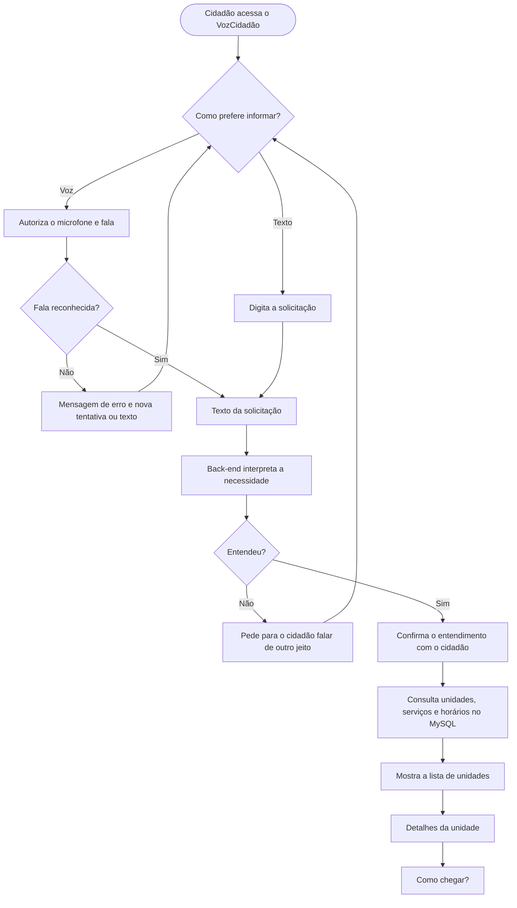
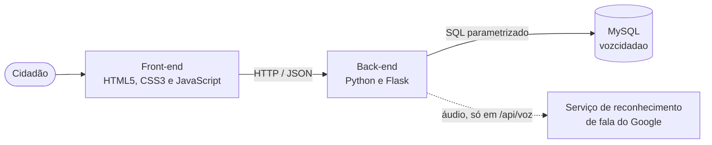
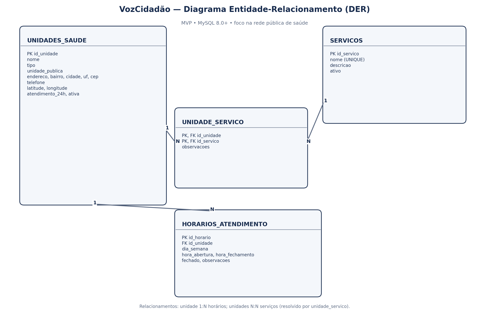
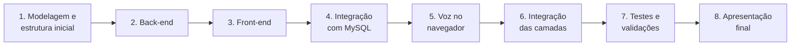
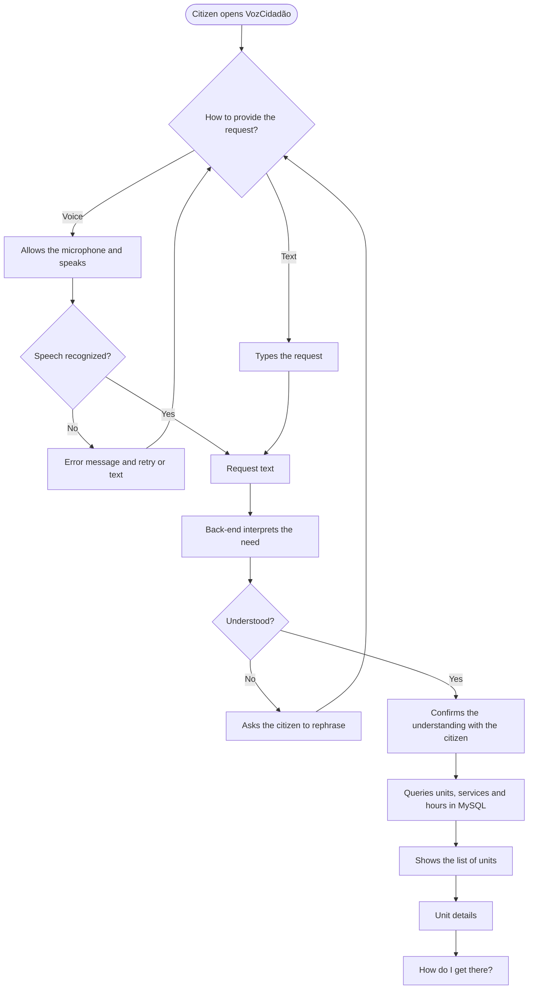
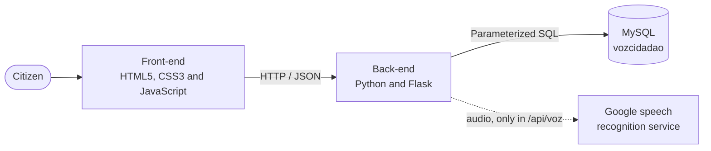
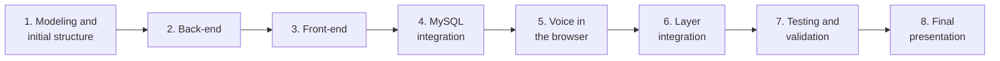

<div align="center">

# VozCidadão

**Fale o que você precisa. O VozCidadão ajuda você a encontrar.**

Acessibilidade digital por interação por voz nos serviços públicos de saúde.


Centro Universitário Maurício de Nassau (UNINASSAU) · Campus Recife (Graças) · Semestre 2026.2
Professor responsável: Breno Holanda

🇧🇷 [Português](#portugues) | 🇺🇸 [English](#english)

</div>

---

<a id="portugues"></a>

# Português

## Sumário

1. [Sobre o Projeto](#1-sobre-o-projeto)
2. [Problema Identificado](#2-problema-identificado)
3. [Objetivos](#3-objetivos)
4. [Público-alvo e Benefícios](#4-público-alvo-e-benefícios)
5. [Funcionalidades](#5-funcionalidades)
6. [Fluxo de Funcionamento](#6-fluxo-de-funcionamento)
7. [Tecnologias e Ferramentas](#7-tecnologias-e-ferramentas)
8. [Arquitetura do Sistema](#8-arquitetura-do-sistema)
9. [Reconhecimento Automático de Fala](#9-reconhecimento-automático-de-fala)
10. [Estrutura do Repositório](#10-estrutura-do-repositório)
11. [Banco de Dados](#11-banco-de-dados)
12. [Instalação e Execução (passo a passo)](#12-instalação-e-execução-passo-a-passo)
13. [API e Integração](#13-api-e-integração)
14. [Acessibilidade](#14-acessibilidade)
15. [Segurança e Privacidade](#15-segurança-e-privacidade)
16. [Testes e Qualidade](#16-testes-e-qualidade)
17. [Equipe](#17-equipe)
18. [Cronograma](#18-cronograma)
19. [Roadmap do Projeto](#19-roadmap-do-projeto)
20. [Documentação Complementar](#20-documentação-complementar)
21. [Contribuição](#21-contribuição)
22. [Licença e Créditos](#22-licença-e-créditos)

---

## 1. Sobre o Projeto

O VozCidadão é uma solução digital que busca facilitar o acesso dos cidadãos aos serviços públicos de saúde por meio da interação por voz. A principal jornada é encontrar uma unidade pública de saúde próxima (UPA, UBS, hospital etc.), ver os serviços e horários de atendimento e saber como chegar.

A plataforma permite que o cidadão informe sua necessidade falando ou digitando, reduzindo as dificuldades de interfaces com muitos menus, botões e formulários. O objetivo é tornar a experiência mais simples, intuitiva, acessível e inclusiva.

Trata-se de um projeto acadêmico de desenvolvimento de software com propósito social, na interseção entre tecnologia, acessibilidade digital e serviços públicos de saúde.

| Item | Informação |
|---|---|
| Nome oficial | VozCidadão |
| Instituição | Centro Universitário Maurício de Nassau (UNINASSAU) |
| Campus | Recife (Graças) |
| Semestre | 2026.2 |
| Professor responsável | Breno Holanda |
| Natureza | Projeto acadêmico de desenvolvimento de software |
| Área | Tecnologia, acessibilidade digital e serviços públicos de saúde |

> **Relevância social.** Quando o acesso digital depende de navegar por muitas etapas, parte da população fica dependente de terceiros ou do atendimento presencial. Ao oferecer a voz como forma de interação, o projeto busca ampliar a autonomia do cidadão e contribuir para a inclusão digital.

[↑ Voltar ao início](#portugues)

---

## 2. Problema Identificado

A digitalização dos serviços públicos ampliou as possibilidades de acesso à informação, mas nem todos os cidadãos conseguem utilizar essas plataformas com facilidade. Interfaces baseadas em menus, botões, formulários e várias etapas podem se tornar uma barreira. Em muitos casos, o cidadão sabe exatamente o que precisa, mas não sabe onde clicar ou qual caminho seguir.

As dificuldades afetam, em especial:

- **Pessoas idosas**, que podem ter menor familiaridade com interfaces digitais e maior insegurança ao utilizá-las.
- **Pessoas com deficiência**, para quem interfaces convencionais podem não oferecer formas de interação adequadas.
- **Pessoas com limitações motoras**, para quem manipular menus, botões e formulários pode ser difícil.
- **Pessoas com pouca familiaridade com tecnologia**, que tendem a depender de familiares ou de outras pessoas.
- **Pessoas com dificuldades de navegação em interfaces complexas**, que enfrentam excesso de etapas para tarefas simples.

No contexto da saúde pública, essa barreira pode dificultar o acesso a informações sobre serviços de saúde. O problema está diretamente ligado à inclusão digital e à acessibilidade: um serviço digital que nem todos conseguem usar não cumpre plenamente seu papel público.

[↑ Voltar ao início](#portugues)

---

## 3. Objetivos

### 3.1 Objetivo Geral

Desenvolver uma aplicação web que facilite o acesso dos cidadãos a informações sobre serviços públicos de saúde por meio da interação por voz, promovendo acessibilidade, autonomia e inclusão digital.

### 3.2 Objetivos Específicos

- Permitir que o cidadão expresse sua necessidade por meio da fala.
- Utilizar reconhecimento automático de fala para converter a fala em texto.
- Interpretar a solicitação e confirmar o entendimento com o cidadão antes de apresentar resultados.
- Apresentar informações sobre serviços públicos de saúde de forma clara e objetiva.
- Oferecer uma alternativa de entrada textual para quando a voz não estiver disponível ou não funcionar.
- Organizar e persistir os dados da aplicação em um banco de dados MySQL.
- Adotar boas práticas de acessibilidade, tendo a WCAG 2.2 como referência.
- Documentar a arquitetura, o banco de dados, a API e os testes do projeto.

[↑ Voltar ao início](#portugues)

---

## 4. Público-alvo e Benefícios

**Público-alvo:** pessoas idosas, pessoas com deficiência, pessoas com limitações motoras, pessoas com pouca familiaridade com tecnologia e pessoas com dificuldades de navegação em interfaces complexas. Embora o foco seja a acessibilidade, a solução também pode beneficiar qualquer cidadão que prefira usar comandos de voz.

| Benefício | Descrição |
|---|---|
| Acessibilidade | Oferece uma forma alternativa de interação, reduzindo barreiras das interfaces tradicionais. |
| Autonomia | Permite que o cidadão realize tarefas sem depender de outras pessoas. |
| Simplicidade | Reduz a necessidade de procurar funções em menus e de percorrer várias etapas. |
| Inclusão digital | Torna os serviços públicos digitais acessíveis a perfis variados de usuários. |
| Clareza na comunicação | A confirmação da solicitação mostra ao usuário o que o sistema compreendeu. |
| Redução de barreiras de navegação | O cidadão diz o que precisa em vez de descobrir o caminho até a informação. |

[↑ Voltar ao início](#portugues)

---

## 5. Funcionalidades

A coluna **Situação** separa o que já existe no back-end do que ainda depende do front-end ou de decisão da equipe. Os testes do back-end foram feitos em ambiente de teste com MariaDB e ainda precisam ser repetidos em MySQL 8 (ver [seção 16](#16-testes-e-qualidade)).

| Funcionalidade | Descrição | Situação |
|---|---|---|
| Busca de unidades de saúde próximas | Lista unidades públicas filtradas por tipo e serviço, ordenadas pela distância a partir da localização informada. | Back-end implementado; front-end pendente |
| Detalhes da unidade | Endereço, telefone, serviços oferecidos, horários por dia da semana e se está aberta agora. | Back-end implementado; front-end pendente |
| Catálogo de serviços | Lista de serviços de saúde (ex.: vacinação, pediatria) para sugestões clicáveis. | Back-end implementado; front-end pendente |
| Identificação da necessidade | Interpreta a frase (voz ou texto), como "UPA mais próxima" ou "preciso de um pediatra". | Back-end implementado |
| Entrada textual alternativa | O back-end aceita a frase em texto. O campo de digitação na interface ainda precisa ser feito. | Back-end implementado; front-end pendente |
| Aviso de emergência | Em buscas por UPA, hospital ou urgência, a resposta traz a orientação de ligar para o SAMU (192). | Back-end implementado |
| Interação por voz | O back-end capta a voz pelo microfone da máquina onde o servidor roda (uso de demonstração local). A captura pelo microfone do cidadão, no navegador, ainda não existe. | Parcial |
| Confirmação das solicitações | Mostrar o que o sistema entendeu e pedir confirmação antes dos resultados. | Planejada |
| "Como chegar?" | Último passo da jornada da AV1: orientar o trajeto até a unidade escolhida. | Planejada (não implementada) |
| Guias passo a passo (gov.br, INSS etc.) | Presentes no código do back-end, mas fora do escopo de saúde da AV1 e sem tabela no banco. **A equipe precisa decidir se mantém e justifica, ou remove.** | Decisão pendente |

**Resumo por situação**

- **Implementadas no back-end:** busca de unidades, detalhes, catálogo de serviços, interpretação de frases, entrada por texto e aviso de emergência.
- **Parcial:** interação por voz (somente pelo microfone do servidor).
- **Planejadas:** interface (front-end), confirmação das solicitações e "Como chegar?".
- **Decisão pendente:** guias fora do escopo de saúde.

[↑ Voltar ao início](#portugues)

---

## 6. Fluxo de Funcionamento



Caminhos alternativos previstos: permissão do microfone negada, falha no reconhecimento de fala, solicitação não compreendida e uso de entrada textual. O passo "Confirma o entendimento" e o passo "Como chegar?" ainda não estão implementados.

[↑ Voltar ao início](#portugues)

---

## 7. Tecnologias e Ferramentas

### 7.1 Tecnologias confirmadas

| Camada | Tecnologia | Responsabilidade | Situação |
|---|---|---|---|
| Front-end | HTML5 | Estruturação da interface. | Definido |
| Estilização | CSS3 | Apresentação visual, responsividade e estilos acessíveis. | Definido |
| Interatividade | JavaScript puro | Interatividade, validações e integração com os recursos de voz. | Definido |
| Back-end | Python 3.9+ e **Flask** | Regras de negócio e API REST em JSON. | Implementado |
| Back-end (bibliotecas) | `flask-cors`, `mysql-connector-python`, `SpeechRecognition` (opcional, para voz) | CORS, conexão com o MySQL (pool de conexões) e reconhecimento de fala. | Implementado |
| Banco de dados | MySQL 8.0+ | Persistência e gerenciamento dos dados. | Scripts DDL e DML prontos |
| Versionamento | Git e GitHub | Controle de versão e colaboração. | Em uso |

O front-end não utiliza frameworks: a interface é construída com HTML5, CSS3 e JavaScript puro.

### 7.2 Tecnologias em avaliação

| Item | Observação |
|---|---|
| Web Speech API | Possibilidade para captar a voz no navegador do cidadão e enviar só o texto ao back-end. Ainda não confirmada nem implementada. |

### 7.3 Decisões técnicas pendentes

| Decisão | Situação |
|---|---|
| Como a voz será captada no site (navegador x microfone do servidor) | Pendente |
| Escopo dos guias passo a passo (gov.br, INSS etc.) | Pendente |
| Comando e porta para executar o front-end | Pendente |

> **Mudança em relação à AV1.** A documentação da AV1 previa React ou React Native, Node.js e PostgreSQL. Para o projeto da AV2 a equipe adotou HTML5, CSS3 e JavaScript puro, Python (Flask) e MySQL. O edital não fixa tecnologias, e a escolha foi feita pela equipe. [CONFIRMAR o motivo com o grupo e registrar aqui em uma frase]

[↑ Voltar ao início](#portugues)

---

## 8. Arquitetura do Sistema

O VozCidadão é organizado em três camadas: front-end, back-end e banco de dados.



### 8.1 Front-end
- Interface do usuário.
- Captura das interações do cidadão.
- Comunicação com o back-end pela API.

### 8.2 Back-end
- API REST em Flask, com respostas em JSON (ver [seção 13](#13-api-e-integração)).
- Interpretação das frases e regras de negócio (distância, aberto agora, aviso de emergência).
- Validação das entradas e consultas parametrizadas ao banco.
- Pool de conexões com o MySQL.

### 8.3 Banco de Dados
- Armazenamento dos dados de unidades, serviços e horários.
- Consulta e gerenciamento das informações (ver [seção 11](#11-banco-de-dados)).

[↑ Voltar ao início](#portugues)

---

## 9. Reconhecimento Automático de Fala

O reconhecimento automático de fala (ASR, do inglês *Automatic Speech Recognition*) é um dos principais diferenciais do VozCidadão.

**Como está hoje no código:**

- O endpoint `POST /api/voz` usa a biblioteca `SpeechRecognition`, com `recognize_google` e idioma `pt-BR`.
- A captura usa `sr.Microphone()`, ou seja, o **microfone da máquina onde o Python executa**, e não o do cidadão que acessa o site. Isso serve para demonstração local. Em um site, a voz precisa ser captada no navegador (JavaScript) e só o texto deve ir para `POST /api/comando`.
- O código não salva o áudio em arquivo, mas o áudio é enviado ao serviço de reconhecimento do Google. O que esse serviço faz com ele não foi verificado pela equipe.
- A biblioteca é opcional. Se não estiver instalada, a API devolve uma mensagem de erro clara.

**Requisitos de projeto:**

- **Permissão do microfone:** depende de autorização explícita do usuário. O sistema deve explicar por que o acesso é necessário e tratar a recusa oferecendo outro caminho.
- **Tratamento de falhas:** o back-end já devolve mensagens para "não ouvi", "não entendi", "sem conexão" e "microfone indisponível". O front-end deve mostrá-las e oferecer nova tentativa ou entrada textual.
- **Confirmação:** o entendimento do sistema deve ser apresentado ao cidadão e confirmado antes dos resultados, pois o reconhecimento pode errar.
- **Alternativa textual:** toda tarefa possível por voz deve poder ser feita por texto.
- **Compatibilidade entre navegadores:** precisa ser testada nos navegadores-alvo se a voz passar a ser captada no navegador. [PREENCHER: navegadores suportados]

[↑ Voltar ao início](#portugues)

---

## 10. Estrutura do Repositório

```text
ProjetoVozCidadao/
├── backend/
│   ├── comandos.py            # API Flask e regras de negócio
│   └── requirements.txt       # dependências Python
├── frontend/                  # HTML5, CSS3 e JavaScript
├── banco_de_dados/
│   ├── modelagem/             # arquivos-fonte da modelagem, se houver (ex.: .mwb)
│   ├── ddl.sql                # criação do banco, tabelas e view
│   └── dml.sql                # dados de demonstração
├── docs/
│   └── images/
│       └── der.png            # diagrama entidade-relacionamento
└── README.md
```

| Caminho | Finalidade |
|---|---|
| `backend/comandos.py` | Código do back-end em Python (Flask). |
| `backend/requirements.txt` | Lista de dependências para `pip install -r`. |
| `frontend/` | Código do front-end HTML5, CSS3 e JavaScript. |
| `banco_de_dados/ddl.sql` | Script de criação do banco `vozcidadao`, das tabelas e da view. |
| `banco_de_dados/dml.sql` | Script de inserção de dados de demonstração. |
| `banco_de_dados/modelagem/` | Arquivos-fonte da modelagem do banco. |
| `docs/images/` | Imagens da documentação, como o DER. |

[↑ Voltar ao início](#portugues)

---

## 11. Banco de Dados

**SGBD utilizado:** MySQL 8.0 ou superior. **Nome do banco:** `vozcidadao` (codificação `utf8mb4`).

### 11.1 Modelagem Lógica e DER

O modelo tem quatro tabelas e uma view, com foco na rede pública de saúde. Uma unidade tem vários horários (1:N), e unidades e serviços se relacionam de muitos para muitos (N:N), resolvido pela tabela `unidade_servico`.



### 11.2 Entidades Principais

| Entidade | Responsabilidade | Chave primária | Chaves estrangeiras |
|---|---|---|---|
| `unidades_saude` | Unidades públicas de saúde, com endereço e coordenadas. | `id_unidade` | — |
| `servicos` | Catálogo de serviços de saúde. | `id_servico` | — |
| `unidade_servico` | Liga unidades aos serviços que oferecem (N:N). | `id_unidade` + `id_servico` | `id_unidade` → `unidades_saude`; `id_servico` → `servicos` |
| `horarios_atendimento` | Horário de funcionamento por unidade e dia da semana. | `id_horario` | `id_unidade` → `unidades_saude` |
| `vw_unidades_servicos_horarios` (view) | Reúne unidade, serviço e horário para consultas. | — | — |

**Atributos por entidade**

| Entidade | Atributos |
|---|---|
| `unidades_saude` | `id_unidade`, `nome`, `tipo` (HOSPITAL, UPA, UBS, POLICLINICA, CAPS), `unidade_publica`, `endereco`, `bairro`, `cidade`, `uf`, `cep`, `telefone`, `latitude`, `longitude`, `atendimento_24h`, `ativa` |
| `servicos` | `id_servico`, `nome` (único), `descricao`, `ativo` |
| `unidade_servico` | `id_unidade`, `id_servico`, `observacoes` |
| `horarios_atendimento` | `id_horario`, `id_unidade`, `dia_semana`, `hora_abertura`, `hora_fechamento`, `fechado`, `observacoes` |

**Relacionamentos e regras**

- `unidades_saude` 1:N `horarios_atendimento`: uma unidade tem até um horário por dia da semana (`UNIQUE (id_unidade, dia_semana)`).
- `unidades_saude` N:N `servicos`, por meio de `unidade_servico`.
- As chaves estrangeiras usam `ON DELETE CASCADE` e `ON UPDATE CASCADE`.
- `unidade_publica` só aceita `TRUE`, por uma restrição `CHECK`, porque o escopo do MVP é a rede pública.
- Um horário é válido quando `fechado = TRUE` sem horas, ou `fechado = FALSE` com abertura e fechamento preenchidos.
- A coluna `cidade` permite ampliar a cobertura além de Recife sem alterar a modelagem.

### 11.3 Scripts SQL

| Script | Finalidade | Situação |
|---|---|---|
| `banco_de_dados/ddl.sql` | Cria o banco, as tabelas e a view. Começa com `DROP ... IF EXISTS`, então pode ser executado de novo. **Apaga as tabelas do projeto antes de recriá-las.** | Disponível |
| `banco_de_dados/dml.sql` | Insere 3 unidades, 4 serviços, 7 ligações e 21 horários. Usa `ON DUPLICATE KEY UPDATE`, então não duplica ao repetir. | Disponível |

> **Atenção:** os dados do `dml.sql` são **fictícios**, só para demonstração (ex.: "UPA Exemplo Norte", endereços e coordenadas inventados). Antes da apresentação, substitua por dados de fonte oficial da Prefeitura do Recife ou da Secretaria Municipal de Saúde.

[↑ Voltar ao início](#portugues)

---

## 12. Instalação e Execução (passo a passo)

Os comandos abaixo valem para Windows (Git Bash ou PowerShell), Linux e macOS. Onde há diferença, ela está indicada.

### Passo 1. Pré-requisitos

- Git
- Python 3.9 ou superior (o código usa `zoneinfo`)
- MySQL Server 8.0 ou superior (e, se quiser, MySQL Workbench ou DBeaver)
- Navegador atualizado

### Passo 2. Clonar o repositório

```bash
git clone https://github.com/Dudad771/ProjetoVozCidadao.git
cd ProjetoVozCidadao
```

### Passo 3. Criar o banco e carregar os dados

Verifique se o servidor MySQL está em execução. Depois, na raiz do projeto, rode os dois scripts **nesta ordem**. O `ddl.sql` já cria o banco `vozcidadao`.

**Opção A: terminal** (Git Bash, CMD, Linux ou macOS)

```bash
mysql -u root -p --default-character-set=utf8mb4 < banco_de_dados/ddl.sql
mysql -u root -p --default-character-set=utf8mb4 < banco_de_dados/dml.sql
```

**Opção B: dentro do cliente `mysql`** (funciona também no PowerShell, onde o símbolo `<` não é aceito)

```bash
mysql -u root -p --default-character-set=utf8mb4
```

```sql
SOURCE banco_de_dados/ddl.sql;
SOURCE banco_de_dados/dml.sql;
```

**Opção C: MySQL Workbench ou DBeaver.** Abra `ddl.sql`, execute o script inteiro, depois abra `dml.sql` e execute também.

> Use `--default-character-set=utf8mb4` ao carregar pelo terminal. Sem isso, os acentos podem ser gravados quebrados e o back-end deixa de reconhecer palavras como "vacina".

### Passo 4. Verificar o banco

```sql
USE vozcidadao;
SELECT COUNT(*) FROM unidades_saude;         -- esperado: 3
SELECT COUNT(*) FROM servicos;               -- esperado: 4
SELECT COUNT(*) FROM unidade_servico;        -- esperado: 7
SELECT COUNT(*) FROM horarios_atendimento;   -- esperado: 21
```

### Passo 5. Criar um usuário próprio para a aplicação (recomendado)

Sem variáveis de ambiente, o back-end conecta como `root` sem senha. Crie um usuário só com permissão de leitura, que é o que a API usa. Troque `SUA_SENHA` por uma senha de sua escolha e **não a registre no repositório**.

```sql
CREATE USER 'vozcidadao_app'@'localhost' IDENTIFIED BY 'SUA_SENHA';
GRANT SELECT ON vozcidadao.* TO 'vozcidadao_app'@'localhost';
FLUSH PRIVILEGES;
```

### Passo 6. Ambiente virtual e dependências do back-end

```bash
cd backend
python -m venv .venv
```

Ative o ambiente virtual:

```bash
# Git Bash (Windows)
source .venv/Scripts/activate

# PowerShell (Windows)
.venv\Scripts\Activate.ps1

# Linux ou macOS
source .venv/bin/activate
```

Instale as dependências:

```bash
pip install -r requirements.txt
```

> **Voz (opcional):** o endpoint `/api/voz` também precisa do PyAudio (`pip install pyaudio`). Sem ele, o restante da API funciona normalmente.

### Passo 7. Configurar as variáveis de ambiente

O back-end lê estas variáveis. Se nenhuma for definida, usa os valores padrão da tabela.

| Variável | Padrão | Descrição |
|---|---|---|
| `DB_HOST` | `localhost` | Servidor do MySQL |
| `DB_PORT` | `3306` | Porta do MySQL |
| `DB_USER` | `root` | Usuário do banco |
| `DB_PASSWORD` | (vazio) | Senha do usuário |
| `DB_NAME` | `vozcidadao` | Nome do banco |

O código não carrega arquivos `.env` sozinho, então defina as variáveis no terminal antes de iniciar:

```bash
# Git Bash, Linux ou macOS
export DB_USER=vozcidadao_app
export DB_PASSWORD='SUA_SENHA'
```

```powershell
# PowerShell
$env:DB_USER = "vozcidadao_app"
$env:DB_PASSWORD = "SUA_SENHA"
```

Nunca registre senhas ou credenciais neste README ou no repositório.

### Passo 8. Iniciar o back-end

Na pasta `backend/`, com o ambiente virtual ativo:

```bash
python comandos.py
```

A API sobe em **http://127.0.0.1:5000**. O arquivo roda com `debug=True`, que serve só para desenvolvimento.

### Passo 9. Testar a API

Com o back-end rodando, em outro terminal (Git Bash, Linux ou macOS):

```bash
# Lista os serviços cadastrados
curl http://127.0.0.1:5000/api/servicos

# Interpreta uma frase e busca unidades, com a localização do usuário
curl -X POST http://127.0.0.1:5000/api/comando \
  -H "Content-Type: application/json" \
  -d '{"texto": "UPA mais próxima", "lat": -8.05, "lon": -34.88}'

# Busca direta por tipo de unidade
curl -X POST http://127.0.0.1:5000/api/unidades/buscar \
  -H "Content-Type: application/json" \
  -d '{"tipo": "UBS", "lat": -8.05, "lon": -34.88, "limite": 3}'

# Detalhes de uma unidade
curl http://127.0.0.1:5000/api/unidades/1
```

No PowerShell, use o Git Bash para estes comandos, porque `curl` ali é um apelido para outro comando.

### Passo 10. Iniciar o front-end

[PREENCHER: comando ou procedimento para executar o front-end, e o endereço e a porta de acesso. Responsável: Ludmila]

O back-end já libera chamadas de outras origens (CORS), então o front-end pode ser aberto separadamente e chamar `http://127.0.0.1:5000`.

### Passo 11. Checklist de verificação

- [ ] O banco `vozcidadao` foi criado e as quatro tabelas existem.
- [ ] As contagens do Passo 4 batem.
- [ ] O back-end iniciou sem erros e `GET /api/servicos` devolve os 4 serviços.
- [ ] `POST /api/comando` com "UPA mais próxima" devolve a UPA de exemplo.
- [ ] Os acentos aparecem corretos nas respostas.
- [ ] O front-end carrega no navegador.
- [ ] O front-end se comunica com o back-end.

[↑ Voltar ao início](#portugues)

---

## 13. API e Integração

API REST em Flask, com entrada e saída em JSON, no endereço base `http://127.0.0.1:5000`. Os erros voltam sempre em JSON, no formato `{"erro": "mensagem"}`.

| Método | Endpoint | Finalidade | Parâmetros | Resposta |
|---|---|---|---|---|
| GET | `/api/servicos` | Lista os serviços ativos. | — | Lista de `{id, nome, descricao}` |
| GET | `/api/unidades/<id>` | Detalhes de uma unidade. | `id` na URL | Unidade com serviços, horários e `aberto`. `404` se não existir |
| POST | `/api/unidades/buscar` | Busca unidades com filtros. | `tipo`, `id_servico`, `bairro`, `cidade`, `limite` (1 a 20, padrão 3), `lat`, `lon` | Lista de unidades, da mais próxima para a mais distante quando há `lat` e `lon`. `400` para tipo inválido |
| POST | `/api/comando` | Interpreta uma frase e responde. | `texto` (obrigatório, até 300 caracteres), `lat`, `lon`, `bairro`, `cidade` | `texto`, `intencao`, `mensagem`, `unidades` ou `guia`, e `aviso` quando for emergência. `400` se o texto vier vazio |
| POST | `/api/voz` | Escuta o microfone **do servidor** e processa a frase. Só para demonstração local. | `lat`, `lon`, `bairro`, `cidade` | Igual a `/api/comando`. `422` se a voz falhar |
| GET | `/api/guias` | Lista os guias passo a passo. | — | Lista de guias (fora do escopo de saúde, ver seção 5) |
| GET | `/api/guias/<chave>` | Um guia específico. | `chave` na URL | Guia com passos. `404` se não existir |

**Tipos válidos em `tipo`:** `HOSPITAL`, `UPA`, `UBS`, `POLICLINICA`, `CAPS`.

**Campos de cada unidade na resposta:** `id`, `nome`, `tipo`, `tipo_nome`, `endereco`, `bairro`, `cidade`, `uf`, `cep`, `telefone`, `lat`, `lon`, `atendimento_24h`, `servicos`, `horarios`, `aberto` (`true`, `false` ou `null` se não há horário cadastrado). Quando a requisição traz localização, vêm também `dist_m`, `distancia` (ex.: "1,2 km") e `minutos` (a pé, estimado).

[↑ Voltar ao início](#portugues)

---

## 14. Acessibilidade

As práticas abaixo são metas de projeto, com a WCAG 2.2 como referência. Este projeto não declara conformidade ou certificação, que dependem de testes.

| Prática | Descrição | Situação |
|---|---|---|
| Interface responsiva | Adaptação a diferentes tamanhos de tela. | Meta, não verificada |
| Contraste adequado | Cores com contraste suficiente entre texto e fundo. | Meta, não verificada |
| Textos legíveis | Tamanho, espaçamento e linguagem simples. | Meta, não verificada |
| Botões com identificação clara | Rótulos textuais compreensíveis em todos os controles. | Meta, não verificada |
| Navegação por teclado | Todas as funções acessíveis sem mouse, com foco visível. | Meta, não verificada |
| Tecnologias assistivas | Estrutura semântica compatível com leitores de tela. | Meta, não verificada |
| Alternativa textual à voz | Toda ação por voz também possível por texto. | Meta, não verificada |
| Feedback visual e textual | Indicação clara de que o sistema está ouvindo, processando ou concluiu. | Meta, não verificada |
| Mensagens de erro compreensíveis | Erros descritos em linguagem simples, com orientação do que fazer. | Meta, não verificada |
| Confirmação de ações | O sistema confirma o entendimento antes de prosseguir. | Meta, não verificada |

[↑ Voltar ao início](#portugues)

---

## 15. Segurança e Privacidade

As recomendações abaixo orientam o desenvolvimento. A implementação ainda precisa ser validada e este projeto não declara conformidade com a LGPD.

**O que o projeto já faz**

- **Sem dados do usuário no banco:** o modelo não tem tabelas de usuários, buscas, transcrições, localização nem tipo de deficiência. O back-end não grava a frase nem a localização, que são usadas só durante a requisição.
- **Consultas parametrizadas:** as consultas SQL usam parâmetros, o que protege contra injeção de SQL.
- **Validação de entradas:** o back-end valida tipo, números, coordenadas e limita o texto a 300 caracteres.
- **Escopo público:** o banco só aceita unidades públicas.

**O que precisa de atenção**

- **Áudio enviado ao Google:** `POST /api/voz` envia o áudio ao serviço de reconhecimento do Google. Isso deve ser informado ao usuário com clareza e verificado pela equipe.
- **Credenciais:** sem variáveis de ambiente, o back-end conecta como `root` sem senha. Use o usuário do Passo 5, com permissão só de leitura, e não versione senhas.
- **Antes da entrega final:** `CORS(app)` aceita qualquer origem e `debug=True` está ligado. Restrinja as origens e desligue o modo debug.
- **HTTPS:** preferir conexões cifradas quando a aplicação for disponibilizada.
- **Permissão do microfone:** solicitar somente quando necessário, explicar o motivo e respeitar a recusa.
- **Cuidados com informações de saúde:** dados de saúde são dados pessoais sensíveis pela LGPD. Qualquer histórico futuro exigiria consentimento e prazo de retenção.
- **Princípios da LGPD:** finalidade, adequação, necessidade, transparência, segurança e prevenção como orientações de projeto.

[↑ Voltar ao início](#portugues)

---

## 16. Testes e Qualidade

Marque o andamento conforme os testes forem planejados, executados e aprovados.

| Tipo de teste | Escopo | Planejado | Executado | Aprovado |
|---|---|:---:|:---:|:---:|
| Funcionais | Fluxos principais do sistema | ☐ | ☐ | ☐ |
| Integração | Comunicação entre front-end, back-end e banco | ☐ | ☐ | ☐ |
| Banco de dados | Estrutura, integridade e consultas | ☐ | ☐ | ☐ |
| API | Endpoints, parâmetros e respostas | ☐ | ☐ | ☐ |
| Interface | Usabilidade e comportamento visual | ☐ | ☐ | ☐ |
| Reconhecimento de fala | Captura, reconhecimento, falhas e confirmação | ☐ | ☐ | ☐ |
| Acessibilidade | Teclado, contraste, leitores de tela e demais práticas | ☐ | ☐ | ☐ |

Evidências dos testes devem ser guardadas em `docs/`. Os testes de API e banco feitos até agora usaram MariaDB e não cobriram a captura de voz. Repita em MySQL 8 antes de marcar como aprovado.

[↑ Voltar ao início](#portugues)

---

## 17. Equipe

| Integrante | Responsabilidade |
|---|---|
| Eduarda | QA / Testes |
| Danilo | Desenvolvimento Back-end |
| Ludmila | Desenvolvimento Front-end |
| Wesley | Banco de Dados / DBA |
| Mateus | Documentação, Repositório e Apresentação |

[↑ Voltar ao início](#portugues)

---

## 18. Cronograma

| Data | Etapa | Entregáveis | Status |
|---|---|---|---|
| 30/10/2026 | Ponto de verificação 1 | Repositório, modelagem lógica e DDL inicial | [ATUALIZAR] |
| 13/11/2026 | Ponto de verificação 2 | Endpoints principais e conexão com o banco | [ATUALIZAR] |
| 27/11/2026 | Ponto de verificação 3 | MVP integrado | [ATUALIZAR] |
| 01/12 a 08/12/2026 | Apresentação oficial | Pitch técnico, repositório final e demonstração | [ATUALIZAR] |

A equipe precisa registrar o andamento real de cada etapa na coluna Status.

[↑ Voltar ao início](#portugues)

---

## 19. Roadmap do Projeto



| Etapa | Descrição | Situação |
|---|---|---|
| 1 | Modelagem e estrutura inicial | DER, DDL e DML prontos |
| 2 | Desenvolvimento do back-end | API e conexão com o MySQL prontas; ajustes pendentes (ver seção 15) |
| 3 | Desenvolvimento do front-end | Planejada |
| 4 | Integração com MySQL | Back-end integrado ao MySQL |
| 5 | Implementação da interação por voz | Parcial (microfone do servidor); captura no navegador planejada |
| 6 | Integração das camadas | Planejada |
| 7 | Testes e validações | Planejada |
| 8 | Apresentação final | Planejada |

[↑ Voltar ao início](#portugues)

---

## 20. Documentação Complementar

A pasta `docs/` reúne os materiais de apoio do projeto:

- Diagramas, como o DER em `docs/images/der.png`
- Documentação de arquitetura
- Template de Documentação atualizado (entregável do edital)
- Evidências de testes
- Materiais de apresentação

[↑ Voltar ao início](#portugues)

---

## 21. Contribuição

O que segue é uma proposta para validação da equipe.

- **Branches:** manter uma branch principal estável e desenvolver cada tarefa em uma branch própria, com nome que indique o assunto.
- **Commits:** mensagens curtas e descritivas, em um padrão único definido pela equipe. [PREENCHER: padrão]
- **Código Python:** seguir a PEP 8 (nomes em `snake_case`, linhas curtas, funções pequenas) e separar o código em módulos conforme o back-end crescer.
- **Revisão de código:** alterações revisadas por outro integrante antes de entrar na branch principal.
- **Documentação:** atualizar este README e a pasta `docs/` sempre que uma decisão técnica for tomada ou uma funcionalidade for concluída.

[↑ Voltar ao início](#portugues)

---

## 22. Licença e Créditos

**Licença:** a ser definida pela equipe. [PREENCHER]

**Créditos institucionais:** projeto acadêmico desenvolvido no Centro Universitário Maurício de Nassau (UNINASSAU), Campus Recife (Graças), no semestre 2026.2, sob orientação do professor Breno Holanda.

[↑ Voltar ao início](#portugues)

---

<a id="english"></a>

# English

> **Current status:** academic project under development. Items in square brackets, such as [FILL IN] or [UPDATE], mark information that depends on the team.

## Table of Contents

1. [About the Project](#1-about-the-project)
2. [Problem Statement](#2-problem-statement)
3. [Objectives](#3-objectives)
4. [Target Audience and Benefits](#4-target-audience-and-benefits)
5. [Features](#5-features)
6. [Operation Flow](#6-operation-flow)
7. [Technologies and Tools](#7-technologies-and-tools)
8. [Software Architecture](#8-software-architecture)
9. [Automatic Speech Recognition](#9-automatic-speech-recognition)
10. [Repository Structure](#10-repository-structure)
11. [Database](#11-database)
12. [Installation and Setup (step by step)](#12-installation-and-setup-step-by-step)
13. [API and Integration](#13-api-and-integration)
14. [Accessibility](#14-accessibility)
15. [Security and Privacy](#15-security-and-privacy)
16. [Testing and Quality Assurance](#16-testing-and-quality-assurance)
17. [Team](#17-team)
18. [Schedule](#18-schedule)
19. [Project Roadmap](#19-project-roadmap)
20. [Supplementary Documentation](#20-supplementary-documentation)
21. [Contributing](#21-contributing)
22. [License and Credits](#22-license-and-credits)

---

## 1. About the Project

VozCidadão is a digital solution that makes it easier for citizens to access public healthcare services through voice interaction. The main journey is finding a nearby public health unit (UPA, UBS, hospital, etc.), checking its services and opening hours, and knowing how to get there.

The platform lets citizens state their needs by speaking or typing, reducing the difficulties of interfaces with many menus, buttons and forms. The goal is a simpler, more intuitive, accessible and inclusive experience.

It is an academic software development project with a social purpose, at the intersection of technology, digital accessibility and public healthcare services.

| Item | Information |
|---|---|
| Official name | VozCidadão |
| Institution | Centro Universitário Maurício de Nassau (UNINASSAU) |
| Campus | Recife (Graças) |
| Term | 2026.2 |
| Supervising professor | Breno Holanda |
| Nature | Academic software development project |
| Area | Technology, digital accessibility and public healthcare services |

> **Social relevance.** When digital access depends on going through many steps, part of the population ends up relying on other people or on in-person service. By offering voice as a way to interact, the project seeks to increase citizens' autonomy and contribute to digital inclusion.

[↑ Back to top](#english)

---

## 2. Problem Statement

The digitalization of public services has widened access to information, but not every citizen can use these platforms easily. Interfaces based on menus, buttons, forms and multiple steps can become a barrier. In many cases, citizens know exactly what they need but do not know where to click or which path to follow.

The difficulties especially affect:

- **Older adults**, who may be less familiar with digital interfaces and feel less confident using them.
- **People with disabilities**, for whom conventional interfaces may not offer suitable ways of interacting.
- **People with motor limitations**, for whom handling menus, buttons and forms can be hard.
- **People with little technological familiarity**, who tend to depend on relatives or other people.
- **People who struggle to navigate complex interfaces**, who face too many steps for simple tasks.

In public health, this barrier can make it harder to find information about healthcare services. The problem is directly tied to digital inclusion and accessibility: a digital service that not everyone can use does not fully serve its public purpose.

[↑ Back to top](#english)

---

## 3. Objectives

### 3.1 General Objective

To develop a web application that makes it easier for citizens to access information about public healthcare services through voice interaction, promoting accessibility, autonomy and digital inclusion.

### 3.2 Specific Objectives

- Allow citizens to express their needs by speaking.
- Use automatic speech recognition to convert speech into text.
- Interpret the request and confirm the understanding with the citizen before presenting results.
- Present information about public healthcare services clearly and objectively.
- Offer a text input alternative for when voice is unavailable or fails.
- Organize and persist the application's data in a MySQL database.
- Adopt accessibility best practices, using WCAG 2.2 as a reference.
- Document the project's architecture, database, API and tests.

[↑ Back to top](#english)

---

## 4. Target Audience and Benefits

**Target audience:** older adults, people with disabilities, people with motor limitations, people with little technological familiarity and people who struggle to navigate complex interfaces. Although the focus is accessibility, the solution can also benefit any citizen who prefers voice commands.

| Benefit | Description |
|---|---|
| Accessibility | Offers an alternative way of interacting, reducing barriers found in traditional interfaces. |
| Autonomy | Lets citizens carry out tasks without depending on other people. |
| Simplicity | Reduces the need to look for functions in menus and go through multiple steps. |
| Digital inclusion | Makes digital public services accessible to a wider range of users. |
| Clear communication | Confirming the request shows users what the system understood. |
| Fewer navigation barriers | Citizens say what they need instead of figuring out the path to the information. |

[↑ Back to top](#english)

---

## 5. Features

The **Status** column separates what already exists in the back-end from what still depends on the front-end or on a team decision. Back-end tests were run in a test environment with MariaDB and still need to be repeated on MySQL 8 (see [section 16](#16-testing-and-quality-assurance)).

| Feature | Description | Status |
|---|---|---|
| Nearby health unit search | Lists public units filtered by type and service, sorted by distance from the given location. | Back-end implemented; front-end pending |
| Unit details | Address, phone, services offered, hours per weekday and whether it is open now. | Back-end implemented; front-end pending |
| Service catalog | List of health services (e.g. vaccination, pediatrics) for clickable suggestions. | Back-end implemented; front-end pending |
| Identifying the citizen's need | Interprets the phrase (voice or text), such as "nearest UPA" or "I need a pediatrician". | Back-end implemented |
| Alternative text input | The back-end accepts the phrase as text. The typing field in the interface is still to be built. | Back-end implemented; front-end pending |
| Emergency notice | For UPA, hospital or urgent-care searches, the response includes the advice to call SAMU (192). | Back-end implemented |
| Voice interaction | The back-end captures voice from the microphone of the machine running the server (local demo use). Capture from the citizen's microphone, in the browser, does not exist yet. | Partial |
| Request confirmation | Show what the system understood and ask for confirmation before results. | Planned |
| "How do I get there?" | Last step of the AV1 journey: guide the route to the chosen unit. | Planned (not implemented) |
| Step-by-step guides (gov.br, INSS, etc.) | Present in the back-end code, but outside the AV1 health scope and without a database table. **The team must decide whether to keep and justify them, or remove them.** | Decision pending |

**Summary by status**

- **Implemented in the back-end:** unit search, details, service catalog, phrase interpretation, text input and emergency notice.
- **Partial:** voice interaction (server microphone only).
- **Planned:** interface (front-end), request confirmation and "How do I get there?".
- **Decision pending:** guides outside the health scope.

[↑ Back to top](#english)

---

## 6. Operation Flow



Planned alternative paths: microphone permission denied, speech recognition failure, request not understood and use of text input. The "Confirms the understanding" step and the "How do I get there?" step are not implemented yet.

[↑ Back to top](#english)

---

## 7. Technologies and Tools

### 7.1 Confirmed technologies

| Layer | Technology | Responsibility | Status |
|---|---|---|---|
| Front-end | HTML5 | Structure of the interface. | Defined |
| Styling | CSS3 | Visual presentation, responsiveness and accessible styles. | Defined |
| Interactivity | Vanilla JavaScript | Interactivity, validations and integration with voice features. | Defined |
| Back-end | Python 3.9+ and **Flask** | Business rules and JSON REST API. | Implemented |
| Back-end (libraries) | `flask-cors`, `mysql-connector-python`, `SpeechRecognition` (optional, for voice) | CORS, MySQL connection (connection pool) and speech recognition. | Implemented |
| Database | MySQL 8.0+ | Data persistence and management. | DDL and DML scripts ready |
| Version control | Git and GitHub | Version control and collaboration. | In use |

The front-end uses no frameworks: the interface is built with HTML5, CSS3 and vanilla JavaScript.

### 7.2 Technologies under evaluation

| Item | Note |
|---|---|
| Web Speech API | Option to capture voice in the citizen's browser and send only text to the back-end. Neither confirmed nor implemented. |

### 7.3 Pending technical decisions

| Decision | Status |
|---|---|
| How voice will be captured on the site (browser x server microphone) | Pending |
| Scope of the step-by-step guides (gov.br, INSS, etc.) | Pending |
| Command and port to run the front-end | Pending |

> **Change from AV1.** The AV1 documentation planned React or React Native, Node.js and PostgreSQL. For the AV2 project the team adopted HTML5, CSS3 and vanilla JavaScript, Python (Flask) and MySQL. The call for projects does not fix technologies, and the choice was the team's. [CONFIRM the reason with the group and record it here in one sentence]

[↑ Back to top](#english)

---

## 8. Software Architecture

VozCidadão is organized into three layers: front-end, back-end and database.



### 8.1 Front-End Layer
- User interface.
- Capture of the citizen's interactions.
- Communication with the back-end through the API.

### 8.2 Back-End Layer
- Flask REST API with JSON responses (see [section 13](#13-api-and-integration)).
- Phrase interpretation and business rules (distance, open now, emergency notice).
- Input validation and parameterized database queries.
- MySQL connection pool.

### 8.3 Database Layer
- Storage of unit, service and schedule data.
- Querying and management of information (see [section 11](#11-database)).

[↑ Back to top](#english)

---

## 9. Automatic Speech Recognition

Automatic Speech Recognition (ASR) is one of VozCidadão's main differentiators.

**How it works in the code today:**

- The `POST /api/voz` endpoint uses the `SpeechRecognition` library, with `recognize_google` and language `pt-BR`.
- Capture uses `sr.Microphone()`, that is, the **microphone of the machine running Python**, not the microphone of the citizen using the site. This is fine for a local demo. On a website, voice must be captured in the browser (JavaScript) and only the text should be sent to `POST /api/comando`.
- The code does not save audio to a file, but the audio is sent to Google's recognition service. What that service does with it has not been verified by the team.
- The library is optional. If it is not installed, the API returns a clear error message.

**Project requirements:**

- **Microphone permission:** requires explicit user authorization. The system should explain why access is needed and handle a refusal by offering another path.
- **Failure handling:** the back-end already returns messages for "heard nothing", "did not understand", "no connection" and "microphone unavailable". The front-end should show them and offer a retry or text input.
- **Confirmation:** the system's understanding should be shown to the citizen and confirmed before results, since recognition can make mistakes.
- **Text alternative:** every task possible by voice should also be possible by text.
- **Browser compatibility:** must be tested in the target browsers if voice starts being captured in the browser. [FILL IN: supported browsers]

[↑ Back to top](#english)

---

## 10. Repository Structure

```text
ProjetoVozCidadao/
├── backend/
│   ├── comandos.py            # Flask API and business rules
│   └── requirements.txt       # Python dependencies
├── frontend/                  # HTML5, CSS3 and JavaScript
├── banco_de_dados/
│   ├── modelagem/             # modeling source files, if any (e.g. .mwb)
│   ├── ddl.sql                # database, tables and view creation
│   └── dml.sql                # demo data
├── docs/
│   └── images/
│       └── der.png            # entity-relationship diagram
└── README.md
```

| Path | Purpose |
|---|---|
| `backend/comandos.py` | Python (Flask) back-end code. |
| `backend/requirements.txt` | Dependency list for `pip install -r`. |
| `frontend/` | Front-end code (HTML5, CSS3 and JavaScript). |
| `banco_de_dados/ddl.sql` | Script that creates the `vozcidadao` database, tables and view. |
| `banco_de_dados/dml.sql` | Demo data insertion script. |
| `banco_de_dados/modelagem/` | Database modeling source files. |
| `docs/images/` | Documentation images, such as the ERD. |

[↑ Back to top](#english)

---

## 11. Database

**DBMS:** MySQL 8.0 or later. **Database name:** `vozcidadao` (`utf8mb4` encoding).

### 11.1 Logical Model and ERD

The model has four tables and one view, focused on the public health network. A unit has many schedules (1:N), and units and services are related many-to-many (N:N), resolved by the `unidade_servico` table.


### 11.2 Main Entities

| Entity | Responsibility | Primary key | Foreign keys |
|---|---|---|---|
| `unidades_saude` | Public health units, with address and coordinates. | `id_unidade` | — |
| `servicos` | Catalog of health services. | `id_servico` | — |
| `unidade_servico` | Links units to the services they offer (N:N). | `id_unidade` + `id_servico` | `id_unidade` → `unidades_saude`; `id_servico` → `servicos` |
| `horarios_atendimento` | Opening hours per unit and weekday. | `id_horario` | `id_unidade` → `unidades_saude` |
| `vw_unidades_servicos_horarios` (view) | Combines unit, service and schedule for queries. | — | — |

**Attributes per entity**

| Entity | Attributes |
|---|---|
| `unidades_saude` | `id_unidade`, `nome`, `tipo` (HOSPITAL, UPA, UBS, POLICLINICA, CAPS), `unidade_publica`, `endereco`, `bairro`, `cidade`, `uf`, `cep`, `telefone`, `latitude`, `longitude`, `atendimento_24h`, `ativa` |
| `servicos` | `id_servico`, `nome` (unique), `descricao`, `ativo` |
| `unidade_servico` | `id_unidade`, `id_servico`, `observacoes` |
| `horarios_atendimento` | `id_horario`, `id_unidade`, `dia_semana`, `hora_abertura`, `hora_fechamento`, `fechado`, `observacoes` |

**Relationships and rules**

- `unidades_saude` 1:N `horarios_atendimento`: a unit has at most one schedule per weekday (`UNIQUE (id_unidade, dia_semana)`).
- `unidades_saude` N:N `servicos`, through `unidade_servico`.
- Foreign keys use `ON DELETE CASCADE` and `ON UPDATE CASCADE`.
- `unidade_publica` only accepts `TRUE`, through a `CHECK` constraint, because the MVP scope is the public network.
- A schedule is valid when `fechado = TRUE` with no hours, or `fechado = FALSE` with opening and closing times filled in.
- The `cidade` column allows coverage to grow beyond Recife without changing the model.

### 11.3 SQL Scripts

| Script | Purpose | Status |
|---|---|---|
| `banco_de_dados/ddl.sql` | Creates the database, tables and view. Starts with `DROP ... IF EXISTS`, so it can be run again. **It deletes the project's tables before recreating them.** | Available |
| `banco_de_dados/dml.sql` | Inserts 3 units, 4 services, 7 links and 21 schedules. Uses `ON DUPLICATE KEY UPDATE`, so it does not duplicate on repeat. | Available |

> **Warning:** the `dml.sql` data is **fictional**, for demonstration only (e.g. "UPA Exemplo Norte", invented addresses and coordinates). Before the presentation, replace it with data from an official source of the Recife City Hall or the Municipal Health Department.

[↑ Back to top](#english)

---

## 12. Installation and Setup (step by step)

The commands below work on Windows (Git Bash or PowerShell), Linux and macOS. Differences are marked where they exist.

### Step 1. Prerequisites

- Git
- Python 3.9 or later (the code uses `zoneinfo`)
- MySQL Server 8.0 or later (and, optionally, MySQL Workbench or DBeaver)
- Up-to-date browser

### Step 2. Clone the repository

```bash
git clone https://github.com/Dudad771/ProjetoVozCidadao.git
cd ProjetoVozCidadao
```

### Step 3. Create the database and load the data

Make sure the MySQL server is running. Then, from the project root, run both scripts **in this order**. `ddl.sql` already creates the `vozcidadao` database.

**Option A: terminal** (Git Bash, CMD, Linux or macOS)

```bash
mysql -u root -p --default-character-set=utf8mb4 < banco_de_dados/ddl.sql
mysql -u root -p --default-character-set=utf8mb4 < banco_de_dados/dml.sql
```

**Option B: inside the `mysql` client** (also works in PowerShell, where the `<` symbol is not accepted)

```bash
mysql -u root -p --default-character-set=utf8mb4
```

```sql
SOURCE banco_de_dados/ddl.sql;
SOURCE banco_de_dados/dml.sql;
```

**Option C: MySQL Workbench or DBeaver.** Open `ddl.sql`, run the whole script, then open `dml.sql` and run it too.

> Use `--default-character-set=utf8mb4` when loading from the terminal. Without it, accented characters may be stored corrupted and the back-end stops recognizing words such as "vacina".

### Step 4. Check the database

```sql
USE vozcidadao;
SELECT COUNT(*) FROM unidades_saude;         -- expected: 3
SELECT COUNT(*) FROM servicos;               -- expected: 4
SELECT COUNT(*) FROM unidade_servico;        -- expected: 7
SELECT COUNT(*) FROM horarios_atendimento;   -- expected: 21
```

### Step 5. Create a dedicated user for the application (recommended)

With no environment variables, the back-end connects as `root` with no password. Create a read-only user, which is all the API needs. Replace `YOUR_PASSWORD` with a password of your choice and **do not commit it to the repository**.

```sql
CREATE USER 'vozcidadao_app'@'localhost' IDENTIFIED BY 'YOUR_PASSWORD';
GRANT SELECT ON vozcidadao.* TO 'vozcidadao_app'@'localhost';
FLUSH PRIVILEGES;
```

### Step 6. Virtual environment and back-end dependencies

```bash
cd backend
python -m venv .venv
```

Activate the virtual environment:

```bash
# Git Bash (Windows)
source .venv/Scripts/activate

# PowerShell (Windows)
.venv\Scripts\Activate.ps1

# Linux or macOS
source .venv/bin/activate
```

Install the dependencies:

```bash
pip install -r requirements.txt
```

> **Voice (optional):** the `/api/voz` endpoint also needs PyAudio (`pip install pyaudio`). Without it, the rest of the API works normally.

### Step 7. Set the environment variables

The back-end reads these variables. If none is set, it uses the defaults in the table.

| Variable | Default | Description |
|---|---|---|
| `DB_HOST` | `localhost` | MySQL host |
| `DB_PORT` | `3306` | MySQL port |
| `DB_USER` | `root` | Database user |
| `DB_PASSWORD` | (empty) | User password |
| `DB_NAME` | `vozcidadao` | Database name |

The code does not load `.env` files by itself, so set the variables in the terminal before starting:

```bash
# Git Bash, Linux or macOS
export DB_USER=vozcidadao_app
export DB_PASSWORD='YOUR_PASSWORD'
```

```powershell
# PowerShell
$env:DB_USER = "vozcidadao_app"
$env:DB_PASSWORD = "YOUR_PASSWORD"
```

Never record passwords or credentials in this README or in the repository.

### Step 8. Start the back-end

In the `backend/` folder, with the virtual environment active:

```bash
python comandos.py
```

The API starts at **http://127.0.0.1:5000**. The file runs with `debug=True`, which is for development only.

### Step 9. Test the API

With the back-end running, in another terminal (Git Bash, Linux or macOS):

```bash
# List the registered services
curl http://127.0.0.1:5000/api/servicos

# Interpret a phrase and search units, with the user's location
curl -X POST http://127.0.0.1:5000/api/comando \
  -H "Content-Type: application/json" \
  -d '{"texto": "UPA mais próxima", "lat": -8.05, "lon": -34.88}'

# Direct search by unit type
curl -X POST http://127.0.0.1:5000/api/unidades/buscar \
  -H "Content-Type: application/json" \
  -d '{"tipo": "UBS", "lat": -8.05, "lon": -34.88, "limite": 3}'

# Details of one unit
curl http://127.0.0.1:5000/api/unidades/1
```

On Windows, use Git Bash for these commands, because `curl` in PowerShell is an alias for a different command.

### Step 10. Start the front-end

[FILL IN: command or procedure to run the front-end, and the access address and port. Owner: Ludmila]

The back-end already allows cross-origin calls (CORS), so the front-end can be opened separately and call `http://127.0.0.1:5000`.

### Step 11. Verification checklist

- [ ] The `vozcidadao` database was created and the four tables exist.
- [ ] The counts in Step 4 match.
- [ ] The back-end started without errors and `GET /api/servicos` returns the 4 services.
- [ ] `POST /api/comando` with "UPA mais próxima" returns the sample UPA.
- [ ] Accented characters appear correctly in the responses.
- [ ] The front-end loads in the browser.
- [ ] The front-end communicates with the back-end.

[↑ Back to top](#english)

---

## 13. API and Integration

Flask REST API with JSON input and output, at base address `http://127.0.0.1:5000`. Errors always come back as JSON, in the form `{"erro": "message"}`.

| Method | Endpoint | Purpose | Parameters | Response |
|---|---|---|---|---|
| GET | `/api/servicos` | Lists active services. | — | List of `{id, nome, descricao}` |
| GET | `/api/unidades/<id>` | Details of one unit. | `id` in the URL | Unit with services, schedules and `aberto`. `404` if it does not exist |
| POST | `/api/unidades/buscar` | Searches units with filters. | `tipo`, `id_servico`, `bairro`, `cidade`, `limite` (1 to 20, default 3), `lat`, `lon` | List of units, nearest first when `lat` and `lon` are given. `400` for an invalid type |
| POST | `/api/comando` | Interprets a phrase and responds. | `texto` (required, up to 300 characters), `lat`, `lon`, `bairro`, `cidade` | `texto`, `intencao`, `mensagem`, `unidades` or `guia`, and `aviso` for emergencies. `400` if the text is empty |
| POST | `/api/voz` | Listens to the **server's** microphone and processes the phrase. Local demo only. | `lat`, `lon`, `bairro`, `cidade` | Same as `/api/comando`. `422` if voice fails |
| GET | `/api/guias` | Lists the step-by-step guides. | — | List of guides (outside the health scope, see section 5) |
| GET | `/api/guias/<chave>` | One specific guide. | `chave` in the URL | Guide with steps. `404` if it does not exist |

**Valid values for `tipo`:** `HOSPITAL`, `UPA`, `UBS`, `POLICLINICA`, `CAPS`.

**Fields of each unit in the response:** `id`, `nome`, `tipo`, `tipo_nome`, `endereco`, `bairro`, `cidade`, `uf`, `cep`, `telefone`, `lat`, `lon`, `atendimento_24h`, `servicos`, `horarios`, `aberto` (`true`, `false`, or `null` if no schedule is registered). When the request includes a location, the response also has `dist_m`, `distancia` (e.g. "1,2 km") and `minutos` (estimated walking time).

[↑ Back to top](#english)

---

## 14. Accessibility

The practices below are design goals, with WCAG 2.2 as a reference. This project does not claim conformance or certification, which depend on testing.

| Practice | Description | Status |
|---|---|---|
| Responsive interface | Adapts to different screen sizes. | Goal, not verified |
| Adequate contrast | Sufficient color contrast between text and background. | Goal, not verified |
| Readable text | Size, spacing and plain language. | Goal, not verified |
| Clearly labeled buttons | Understandable text labels on every control. | Goal, not verified |
| Keyboard navigation | All functions available without a mouse, with visible focus. | Goal, not verified |
| Assistive technologies | Semantic structure compatible with screen readers. | Goal, not verified |
| Text alternative to voice | Every voice action also possible by text. | Goal, not verified |
| Visual and text feedback | Clear indication that the system is listening, processing or done. | Goal, not verified |
| Understandable error messages | Errors in plain language, with guidance on what to do. | Goal, not verified |
| Action confirmation | The system confirms its understanding before proceeding. | Goal, not verified |

[↑ Back to top](#english)

---

## 15. Security and Privacy

The recommendations below guide development. The implementation still needs to be validated and this project does not claim LGPD compliance (Brazil's General Data Protection Law).

**What the project already does**

- **No user data in the database:** the model has no tables for users, searches, transcripts, location or disability type. The back-end does not store the phrase or the location, which are used only during the request.
- **Parameterized queries:** SQL queries use parameters, which protects against SQL injection.
- **Input validation:** the back-end validates type, numbers and coordinates, and limits the text to 300 characters.
- **Public scope:** the database only accepts public units.

**What needs attention**

- **Audio sent to Google:** `POST /api/voz` sends audio to Google's recognition service. Users must be told this clearly, and the team should verify it.
- **Credentials:** with no environment variables, the back-end connects as `root` with no password. Use the Step 5 user, with read-only permission, and do not version passwords.
- **Before final delivery:** `CORS(app)` accepts any origin and `debug=True` is on. Restrict the origins and turn debug mode off.
- **HTTPS:** prefer encrypted connections when the application is made available.
- **Microphone permission:** request only when needed, explain why and respect refusal.
- **Care with health information:** health data is sensitive personal data under the LGPD. Any future history would require consent and a retention period.
- **LGPD principles:** purpose, adequacy, necessity, transparency, security and prevention as design guidelines.

[↑ Back to top](#english)

---

## 16. Testing and Quality Assurance

Mark progress as tests are planned, executed and approved.

| Test type | Scope | Planned | Executed | Approved |
|---|---|:---:|:---:|:---:|
| Functional | Main system flows | ☐ | ☐ | ☐ |
| Integration | Communication between front-end, back-end and database | ☐ | ☐ | ☐ |
| Database | Structure, integrity and queries | ☐ | ☐ | ☐ |
| API | Endpoints, parameters and responses | ☐ | ☐ | ☐ |
| Interface | Usability and visual behavior | ☐ | ☐ | ☐ |
| Speech recognition | Capture, recognition, failures and confirmation | ☐ | ☐ | ☐ |
| Accessibility | Keyboard, contrast, screen readers and other practices | ☐ | ☐ | ☐ |

Test evidence should be kept in `docs/`. The API and database tests run so far used MariaDB and did not cover voice capture. Repeat them on MySQL 8 before marking as approved.

[↑ Back to top](#english)

---

## 17. Team

| Member | Responsibility |
|---|---|
| Eduarda | QA / Testing |
| Danilo | Back-End Development |
| Ludmila | Front-End Development |
| Wesley | Database / DBA |
| Mateus | Documentation, Repository and Presentation |

[↑ Back to top](#english)

---

## 18. Schedule

| Date | Stage | Deliverables | Status |
|---|---|---|---|
| 10/30/2026 | Checkpoint 1 | Repository, logical model and initial DDL | [UPDATE] |
| 11/13/2026 | Checkpoint 2 | Main endpoints and database connection | [UPDATE] |
| 11/27/2026 | Checkpoint 3 | Integrated MVP | [UPDATE] |
| 12/01 to 12/08/2026 | Official presentation | Technical pitch, final repository and demonstration | [UPDATE] |

The team needs to record the actual progress of each stage in the Status column.

[↑ Back to top](#english)

---

## 19. Project Roadmap



| Stage | Description | Status |
|---|---|---|
| 1 | Modeling and initial structure | ERD, DDL and DML ready |
| 2 | Back-end development | API and MySQL connection ready; adjustments pending (see section 15) |
| 3 | Front-end development | Planned |
| 4 | MySQL integration | Back-end integrated with MySQL |
| 5 | Voice interaction implementation | Partial (server microphone); browser capture planned |
| 6 | Integration of the layers | Planned |
| 7 | Testing and validation | Planned |
| 8 | Final presentation | Planned |

[↑ Back to top](#english)

---

## 20. Supplementary Documentation

The `docs/` folder gathers the project's supporting materials:

- Diagrams, such as the ERD in `docs/images/der.png`
- Architecture documentation
- Updated Documentation Template (call for projects deliverable)
- Test evidence
- Presentation materials

[↑ Back to top](#english)

---

## 21. Contributing

The following is a proposal for the team to validate.

- **Branches:** keep a stable main branch and develop each task in its own branch, named after its subject.
- **Commits:** short, descriptive messages in a single convention defined by the team. [FILL IN: convention]
- **Python code:** follow PEP 8 (`snake_case` names, short lines, small functions) and split the code into modules as the back-end grows.
- **Code review:** changes reviewed by another member before entering the main branch.
- **Documentation:** update this README and the `docs/` folder whenever a technical decision is made or a feature is completed.

[↑ Back to top](#english)

---

## 22. License and Credits

**License:** to be defined by the team. [FILL IN]

**Institutional credits:** academic project developed at Centro Universitário Maurício de Nassau (UNINASSAU), Recife (Graças) Campus, in the 2026.2 term, under the supervision of Professor Breno Holanda.

[↑ Back to top](#english)
