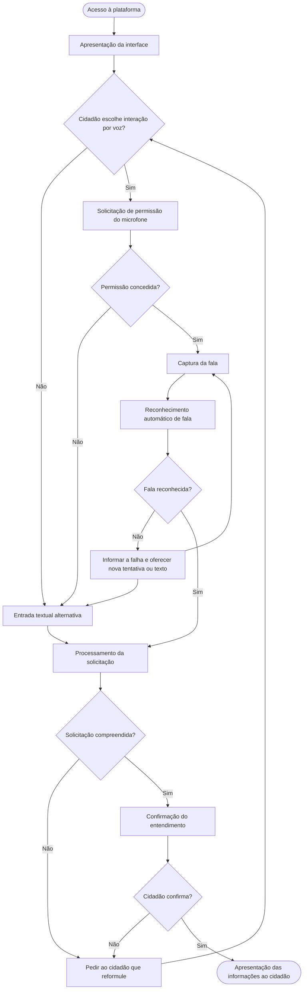
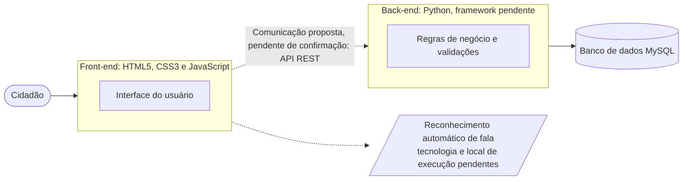
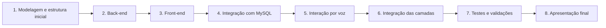
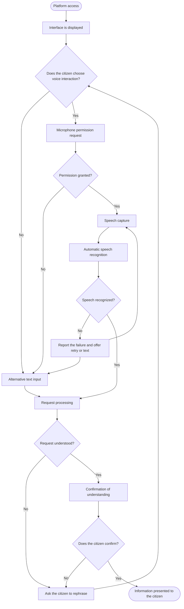
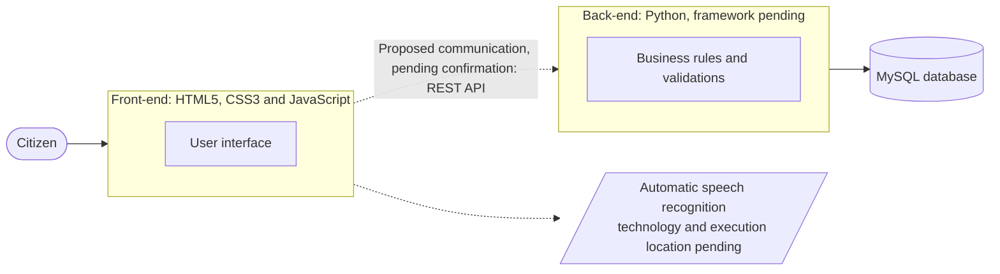
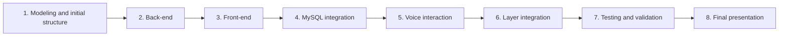

[README (1).md](https://github.com/user-attachments/files/34346820/README.1.md)
<div align="center">

# VozCidadão

**Fale o que você precisa. O VozCidadão ajuda você a encontrar.**

Acessibilidade digital por interação por voz nos serviços públicos de saúde.


Centro Universitário Maurício de Nassau (UNINASSAU) · Campus Recife (Graças) · Semestre 2026.2
Professor responsável: Breno Holanda

[🇧🇷 Português](#português) | [🇺🇸 English](#english)

</div>

---

# Português

**Situação atual:** projeto acadêmico em desenvolvimento. O andamento detalhado de cada etapa está na seção [Cronograma](#18-cronograma) e deve ser mantido atualizado pela equipe.

## Sumário

- [1. Sobre o Projeto](#1-sobre-o-projeto)
- [2. Problema Identificado](#2-problema-identificado)
- [3. Objetivos](#3-objetivos)
  - [3.1 Objetivo Geral](#31-objetivo-geral)
  - [3.2 Objetivos Específicos](#32-objetivos-específicos)
- [4. Público-alvo e Benefícios](#4-público-alvo-e-benefícios)
- [5. Funcionalidades](#5-funcionalidades)
- [6. Fluxo de Funcionamento](#6-fluxo-de-funcionamento)
- [7. Tecnologias e Ferramentas](#7-tecnologias-e-ferramentas)
- [8. Arquitetura do Sistema](#8-arquitetura-do-sistema)
  - [8.1 Front-end](#81-front-end)
  - [8.2 Back-end](#82-back-end)
  - [8.3 Banco de Dados](#83-banco-de-dados)
- [9. Reconhecimento Automático de Fala](#9-reconhecimento-automático-de-fala)
- [10. Estrutura do Repositório](#10-estrutura-do-repositório)
- [11. Banco de Dados](#11-banco-de-dados)
  - [11.1 Modelagem Lógica e DER](#111-modelagem-lógica-e-der)
  - [11.2 Entidades Principais](#112-entidades-principais)
  - [11.3 Scripts SQL](#113-scripts-sql)
- [12. Instalação e Execução](#12-instalação-e-execução)
- [13. API e Integração](#13-api-e-integração)
- [14. Acessibilidade](#14-acessibilidade)
- [15. Segurança e Privacidade](#15-segurança-e-privacidade)
- [16. Testes e Qualidade](#16-testes-e-qualidade)
- [17. Equipe](#17-equipe)
- [18. Cronograma](#18-cronograma)
- [19. Roadmap do Projeto](#19-roadmap-do-projeto)
- [20. Documentação Complementar](#20-documentação-complementar)
- [21. Contribuição](#21-contribuição)
- [22. Licença e Créditos](#22-licença-e-créditos)

> **Convenção deste documento:** itens entre colchetes, como `[PREENCHER]` ou `[ATUALIZAR]`, indicam informações que dependem da equipe. Nada neste README deve ser lido como funcionalidade implementada ou decisão técnica tomada, a menos que esteja explicitamente indicado como tal.

---

## 1. Sobre o Projeto

O **VozCidadão** é uma solução digital que busca facilitar o acesso dos cidadãos aos serviços públicos de saúde por meio da interação por voz.

A plataforma pretende permitir que o cidadão informe suas necessidades utilizando a fala, reduzindo as dificuldades encontradas em interfaces tradicionais com diversos menus, botões e formulários. O objetivo é tornar a experiência mais simples, intuitiva, acessível e inclusiva.

Trata-se de um projeto acadêmico de desenvolvimento de software com propósito social, na interseção entre tecnologia, acessibilidade digital e serviços públicos de saúde.

| Item | Informação |
|---|---|
| Nome oficial | VozCidadão |
| Instituição | Centro Universitário Maurício de Nassau (UNINASSAU) |
| Campus | Recife (Graças) |
| Semestre | 2026.2 |
| Professor responsável | Breno Holanda |
| Natureza | Projeto acadêmico de desenvolvimento de software |
| Área | Tecnologia, acessibilidade digital e serviços públicos de saúde |

**Relevância social.** Quando o acesso digital depende de navegar por muitas etapas, parte da população fica dependente de terceiros ou do atendimento presencial. Ao oferecer a voz como forma de interação, o projeto busca ampliar a autonomia do cidadão e contribuir para a inclusão digital.

[↑ Voltar ao início](#vozcidadão)

---

## 2. Problema Identificado

A digitalização dos serviços públicos ampliou as possibilidades de acesso à informação, mas nem todos os cidadãos conseguem utilizar essas plataformas com facilidade. Interfaces baseadas em menus, botões, formulários e várias etapas podem se tornar uma barreira. Em muitos casos, o cidadão sabe exatamente o que precisa, mas não sabe onde clicar ou qual caminho seguir.

As dificuldades afetam, em especial:

- **Pessoas idosas**, que podem ter menor familiaridade com interfaces digitais e maior insegurança ao utilizá-las.
- **Pessoas com deficiência**, para quem interfaces convencionais podem não oferecer formas de interação adequadas.
- **Pessoas com limitações motoras**, para quem manipular menus, botões e formulários pode ser difícil.
- **Pessoas com pouca familiaridade com tecnologia**, que tendem a depender de familiares ou de outras pessoas.
- **Pessoas com dificuldades de navegação em interfaces complexas**, que enfrentam excesso de etapas para tarefas simples.

No contexto da saúde pública, essa barreira pode dificultar o acesso a informações sobre serviços de saúde. O problema está diretamente ligado à **inclusão digital** e à **acessibilidade**: um serviço digital que nem todos conseguem usar não cumpre plenamente seu papel público.

[↑ Voltar ao início](#vozcidadão)

---

## 3. Objetivos

### 3.1 Objetivo Geral

Desenvolver uma aplicação web que facilite o acesso dos cidadãos a informações sobre serviços públicos de saúde por meio da interação por voz, promovendo acessibilidade, autonomia e inclusão digital.

### 3.2 Objetivos Específicos

- Permitir que o cidadão expresse sua necessidade por meio da fala.
- Utilizar reconhecimento automático de fala para converter a fala em texto (tecnologia ainda a definir).
- Interpretar a solicitação e confirmar o entendimento com o cidadão antes de apresentar resultados.
- Apresentar informações sobre serviços públicos de saúde de forma clara e objetiva.
- Oferecer uma alternativa de entrada textual para quando a voz não estiver disponível ou não funcionar.
- Organizar e persistir os dados da aplicação em um banco de dados MySQL.
- Adotar boas práticas de acessibilidade, tendo a WCAG 2.2 como referência.
- Documentar a arquitetura, o banco de dados, a API e os testes do projeto.

[↑ Voltar ao início](#vozcidadão)

---

## 4. Público-alvo e Benefícios

**Público-alvo:** pessoas idosas, pessoas com deficiência, pessoas com limitações motoras, pessoas com pouca familiaridade com tecnologia e pessoas com dificuldades de navegação em interfaces complexas. Embora o foco seja a acessibilidade, a solução também pode beneficiar qualquer cidadão que prefira usar comandos de voz.

| Benefício | Descrição |
|---|---|
| Acessibilidade | Oferece uma forma alternativa de interação, reduzindo barreiras das interfaces tradicionais. |
| Autonomia | Permite que o cidadão realize tarefas sem depender de outras pessoas. |
| Simplicidade | Reduz a necessidade de procurar funções em menus e de percorrer várias etapas. |
| Inclusão digital | Torna os serviços públicos digitais acessíveis a perfis variados de usuários. |
| Clareza na comunicação | A confirmação da solicitação mostra ao usuário o que o sistema compreendeu. |
| Redução de barreiras de navegação | O cidadão diz o que precisa em vez de descobrir o caminho até a informação. |

[↑ Voltar ao início](#vozcidadão)

---

## 5. Funcionalidades

As funcionalidades abaixo estão **previstas** e sujeitas à validação da equipe. Até o momento, nenhuma está registrada como implementada.

| Funcionalidade | Descrição | Situação |
|---|---|---|
| Interação por voz | O cidadão aciona a plataforma e informa sua necessidade falando. | Planejada |
| Reconhecimento automático de fala | Conversão da fala capturada em texto (tecnologia pendente). | Planejada |
| Identificação da necessidade do cidadão | Interpretação da solicitação para entender o que o usuário procura. | Planejada |
| Confirmação das solicitações | O sistema apresenta o que entendeu e o cidadão confirma antes de prosseguir. | Planejada |
| Apresentação de informações | Exibição clara de informações sobre serviços públicos de saúde. | Planejada |
| Entrada textual alternativa | Opção de digitar quando a voz não estiver disponível ou falhar (proposta). | Planejada |

**Resumo por situação**

- **Implementadas:** nenhuma registrada. `[ATUALIZAR]`
- **Em desenvolvimento:** `[ATUALIZAR]`
- **Planejadas:** todas as funcionalidades da tabela.

[↑ Voltar ao início](#vozcidadão)

---

## 6. Fluxo de Funcionamento

> **Proposta conceitual.** O fluxograma abaixo representa o funcionamento pretendido e ainda não está implementado.



**Caminhos alternativos previstos:** permissão do microfone negada, falha no reconhecimento de fala, solicitação não compreendida e uso de entrada textual.

[↑ Voltar ao início](#vozcidadão)

---

## 7. Tecnologias e Ferramentas

### 7.1 Tecnologias confirmadas

| Camada | Tecnologia | Responsabilidade | Situação |
|---|---|---|---|
| Front-end | HTML5 | Estruturação da interface. | Definido |
| Estilização | CSS3 | Apresentação visual, responsividade e estilos acessíveis. | Definido |
| Interatividade | JavaScript puro | Interatividade, validações e integração com os recursos de voz. | Definido |
| Back-end | Python | Processamento das regras de negócio. | Definido |
| Banco de dados | MySQL | Persistência e gerenciamento dos dados. | Definido |
| Versionamento | Git e GitHub/GitLab | Controle de versão e colaboração. | Conforme configuração do repositório |

O front-end não utiliza frameworks de front-end: a interface é construída com HTML5, CSS3 e JavaScript puro.

### 7.2 Tecnologias em avaliação

| Item | Observação |
|---|---|
| Web Speech API | Possibilidade técnica a avaliar para o reconhecimento de fala. **Não está confirmada nem implementada.** |
| API REST | Proposta arquitetural para a comunicação entre front-end e back-end, pendente de confirmação. |

### 7.3 Decisões técnicas pendentes

| Decisão | Situação |
|---|---|
| Framework do back-end Python | Pendente |
| Tecnologia de reconhecimento de fala | Pendente |
| Forma de comunicação entre front-end e back-end | Pendente |
| Plataforma de hospedagem do repositório (GitHub ou GitLab) | `[CONFIRMAR]` |

[↑ Voltar ao início](#vozcidadão)

---

## 8. Arquitetura do Sistema

O VozCidadão é organizado em três camadas: front-end, back-end e banco de dados.



### 8.1 Front-end

- Interface do usuário.
- Captura das interações do cidadão.
- Comunicação com o back-end.
- Integração com o mecanismo de reconhecimento de fala, conforme a tecnologia que vier a ser definida.

### 8.2 Back-end

- Processamento das solicitações.
- Regras de negócio.
- Validações.
- Comunicação com o banco de dados.

### 8.3 Banco de Dados

- Armazenamento.
- Consulta.
- Gerenciamento das informações.

> A comunicação entre front-end e back-end por API REST é uma proposta arquitetural pendente de confirmação. O diagrama não prevê serviços externos ou integrações além das tecnologias já listadas.

[↑ Voltar ao início](#vozcidadão)

---

## 9. Reconhecimento Automático de Fala

O reconhecimento automático de fala (ASR, do inglês *Automatic Speech Recognition*) é um dos principais diferenciais do VozCidadão. A tecnologia a ser utilizada **ainda não foi definida**.

- **Papel no sistema:** permitir que o cidadão fale em vez de navegar por menus e formulários.
- **Permissão do microfone:** a captura de áudio depende de autorização explícita do usuário. O sistema deve explicar por que o acesso é necessário e tratar a recusa oferecendo outro caminho.
- **Fala em texto:** a fala capturada é convertida em texto, que alimenta o processamento da solicitação.
- **Tratamento de falhas:** o sistema deve informar claramente quando a fala não for reconhecida e oferecer nova tentativa ou entrada textual.
- **Confirmação:** o entendimento do sistema deve ser apresentado ao cidadão e confirmado antes de apresentar resultados, pois o reconhecimento pode errar.
- **Alternativa textual:** toda tarefa possível por voz deve poder ser feita por texto.
- **Compatibilidade entre navegadores:** o suporte depende da tecnologia escolhida e precisa ser testado nos navegadores-alvo. `[PREENCHER: navegadores suportados]`
- **Possibilidade técnica a avaliar:** a Web Speech API é uma alternativa a ser avaliada. Não está confirmada nem implementada.
- **Privacidade:** dependendo da tecnologia adotada, o áudio ou o texto reconhecido pode ser transmitido a serviços externos ou armazenado. Esse comportamento precisa ser verificado tecnicamente antes de qualquer afirmação. Até lá, este documento **não** afirma que o processamento é local nem que o áudio não é armazenado.

[↑ Voltar ao início](#vozcidadão)

---

## 10. Estrutura do Repositório

> Estrutura de referência. A equipe deve conferi-la com o repositório real e ajustar o que não existir.

```
ProjetoVozCidadao/
├── backend/
├── frontend/
├── banco_de_dados/
│   ├── modelagem/
│   ├── ddl.sql
│   └── dml.sql
├── docs/
│   └── images/
└── README.md
```

| Caminho | Finalidade |
|---|---|
| `backend/` | Código do back-end em Python. |
| `frontend/` | Código do front-end (HTML5, CSS3 e JavaScript). |
| `banco_de_dados/modelagem/` | Arquivos de modelagem do banco. |
| `banco_de_dados/ddl.sql` | Script de criação das estruturas do banco. |
| `banco_de_dados/dml.sql` | Script de inserção de dados. |
| `docs/images/` | Imagens da documentação, como o DER. |

[↑ Voltar ao início](#vozcidadão)

---

## 11. Banco de Dados

**SGBD utilizado:** MySQL.

### 11.1 Modelagem Lógica e DER

`[PREENCHER: descrição da modelagem lógica]`

Diagrama entidade-relacionamento: `[PREENCHER: adicionar o arquivo docs/images/der.png]`

<!-- Após adicionar o arquivo, remova este comentário e o texto acima:

-->

### 11.2 Entidades Principais

Esta seção só deve listar tabelas que existam no modelo aprovado pela equipe.

| Entidade | Responsabilidade | Chave primária | Chaves estrangeiras |
|---|---|---|---|
| `[PREENCHER]` | `[PREENCHER]` | `[PREENCHER]` | `[PREENCHER]` |

**Atributos por entidade:** `[PREENCHER]`

**Relacionamentos:** `[PREENCHER: entidades, cardinalidades e chaves estrangeiras]`

### 11.3 Scripts SQL

| Script | Finalidade | Situação |
|---|---|---|
| [`banco_de_dados/ddl.sql`](banco_de_dados/ddl.sql) | Criação das estruturas do banco. | `[CONFIRMAR existência no repositório]` |
| [`banco_de_dados/dml.sql`](banco_de_dados/dml.sql) | Inserção de dados. | `[CONFIRMAR existência no repositório]` |

[↑ Voltar ao início](#vozcidadão)

---

## 12. Instalação e Execução

> Os comandos de execução do back-end e do front-end dependem de decisões ainda pendentes (framework Python e ponto de entrada). Por isso aparecem como campos a preencher.

**1. Pré-requisitos**

- Git
- Python `[PREENCHER: versão]`
- MySQL `[PREENCHER: versão]`
- Navegador atualizado `[PREENCHER: navegadores suportados]`

**2. Clonagem do repositório**

```bash
git clone [PREENCHER: URL do repositório]
cd [PREENCHER: nome da pasta do projeto]
```

**3. Preparação do MySQL**

Verifique se o servidor MySQL está instalado e em execução. `[PREENCHER: orientações específicas da equipe]`

**4. Criação do banco de dados**

```sql
CREATE DATABASE [PREENCHER: nome do banco];
```

**5. Execução do DDL**

```bash
mysql -u [SEU_USUARIO] -p [PREENCHER: nome do banco] < banco_de_dados/ddl.sql
```

**6. Configuração das variáveis de ambiente**

`[PREENCHER: lista de variáveis necessárias]`. Dados de conexão com o banco (servidor, porta, nome do banco, usuário e senha) devem ficar em arquivo de variáveis de ambiente local, fora do controle de versão. Nunca registre senhas ou credenciais neste README ou no repositório.

**7. Inicialização do back-end Python**

```bash
[PREENCHER: comando de inicialização do back-end]
```

**8. Inicialização do front-end**

```bash
[PREENCHER: comando ou procedimento para executar o front-end]
```

**9. Acesso à aplicação**

`[PREENCHER: endereço e porta]`

**10. Verificação do funcionamento**

- [ ] O banco de dados foi criado e as tabelas existem.
- [ ] O back-end iniciou sem erros.
- [ ] O front-end carrega no navegador.
- [ ] O front-end se comunica com o back-end.
- [ ] `[PREENCHER: demais verificações]`

[↑ Voltar ao início](#vozcidadão)

---

## 13. API e Integração

> A API REST é uma proposta arquitetural pendente de confirmação. Os endpoints devem ser documentados aqui somente após definidos pela equipe.

| Método HTTP | Endpoint | Finalidade | Parâmetros | Resposta esperada | Situação |
|---|---|---|---|---|---|
| `[PREENCHER]` | `[PREENCHER]` | `[PREENCHER]` | `[PREENCHER]` | `[PREENCHER]` | Pendente |

[↑ Voltar ao início](#vozcidadão)

---

## 14. Acessibilidade

As práticas abaixo são **metas de projeto**, com a [WCAG 2.2](https://www.w3.org/TR/WCAG22/) como referência. Este projeto **não declara** conformidade ou certificação, que dependem de testes.

| Prática | Descrição | Situação |
|---|---|---|
| Interface responsiva | Adaptação a diferentes tamanhos de tela. | Meta, não verificada |
| Contraste adequado | Cores com contraste suficiente entre texto e fundo. | Meta, não verificada |
| Textos legíveis | Tamanho, espaçamento e linguagem simples. | Meta, não verificada |
| Botões com identificação clara | Rótulos textuais compreensíveis em todos os controles. | Meta, não verificada |
| Navegação por teclado | Todas as funções acessíveis sem mouse, com foco visível. | Meta, não verificada |
| Tecnologias assistivas | Estrutura semântica compatível com leitores de tela. | Meta, não verificada |
| Alternativa textual à voz | Toda ação por voz também possível por texto. | Meta, não verificada |
| Feedback visual e textual | Indicação clara de que o sistema está ouvindo, processando ou concluiu. | Meta, não verificada |
| Mensagens de erro compreensíveis | Erros descritos em linguagem simples, com orientação do que fazer. | Meta, não verificada |
| Confirmação de ações | O sistema confirma o entendimento antes de prosseguir. | Meta, não verificada |

[↑ Voltar ao início](#vozcidadão)

---

## 15. Segurança e Privacidade

As recomendações abaixo orientam o desenvolvimento. A implementação ainda precisa ser validada e **este projeto não declara conformidade com a LGPD**.

- **Proteção de dados pessoais:** coletar apenas os dados estritamente necessários e definir por quanto tempo serão mantidos.
- **Segurança na comunicação entre camadas:** preferir conexões cifradas (HTTPS) quando a aplicação for disponibilizada.
- **Validação de entradas:** validar e tratar toda entrada do usuário, inclusive o texto reconhecido da fala, no front-end e no back-end.
- **Proteção de credenciais:** não versionar senhas, chaves ou dados de conexão. Usar variáveis de ambiente e um arquivo de exemplo sem valores reais.
- **Gerenciamento de permissões:** solicitar a permissão do microfone somente quando necessário, explicar o motivo e respeitar a recusa. Aplicar o princípio do menor privilégio no acesso ao banco.
- **Cuidados com informações de saúde:** dados de saúde são considerados dados pessoais sensíveis pela LGPD e exigem cuidado redobrado. A equipe deve avaliar se o sistema irá tratá-los.
- **Princípios da LGPD:** finalidade, adequação, necessidade, transparência, segurança e prevenção como orientações de projeto.
- **Privacidade durante o reconhecimento de fala:** verificar se o áudio é transmitido a terceiros ou armazenado, e informar o usuário com clareza. `[PREENCHER após definir a tecnologia]`

[↑ Voltar ao início](#vozcidadão)

---

## 16. Testes e Qualidade

Marque o andamento conforme os testes forem planejados, executados e aprovados. Nenhum teste está registrado como executado ou aprovado neste documento.

| Tipo de teste | Escopo | Planejado | Executado | Aprovado |
|---|---|---|---|---|
| Funcionais | Fluxos principais do sistema | ☐ | ☐ | ☐ |
| Integração | Comunicação entre front-end, back-end e banco | ☐ | ☐ | ☐ |
| Banco de dados | Estrutura, integridade e consultas | ☐ | ☐ | ☐ |
| API | Endpoints, parâmetros e respostas | ☐ | ☐ | ☐ |
| Interface | Usabilidade e comportamento visual | ☐ | ☐ | ☐ |
| Reconhecimento de fala | Captura, reconhecimento, falhas e confirmação | ☐ | ☐ | ☐ |
| Acessibilidade | Teclado, contraste, leitores de tela e demais práticas | ☐ | ☐ | ☐ |

Evidências dos testes devem ser guardadas em `docs/`.

[↑ Voltar ao início](#vozcidadão)

---

## 17. Equipe

| Integrante | Responsabilidade |
|---|---|
| Eduarda | QA / Testes |
| Danilo | Desenvolvimento Back-end |
| Ludmila | Desenvolvimento Front-end |
| Wesley | Banco de Dados / DBA |
| Mateus | Documentação, Repositório e Apresentação |

[↑ Voltar ao início](#vozcidadão)

---

## 18. Cronograma

| Data | Etapa | Entregáveis | Status |
|---|---|---|---|
| 30/10/2026 | Ponto de verificação 1 | Repositório, modelagem lógica e DDL inicial | `[ATUALIZAR]` |
| 13/11/2026 | Ponto de verificação 2 | Endpoints principais e conexão com o banco | `[ATUALIZAR]` |
| 27/11/2026 | Ponto de verificação 3 | MVP integrado | `[ATUALIZAR]` |
| 01/12 a 08/12/2026 | Apresentação oficial | Pitch técnico, repositório final e demonstração | `[ATUALIZAR]` |

> Na data de elaboração deste documento (03/11/2026), a data do ponto de verificação 1 já havia passado. A equipe precisa registrar o andamento real de cada etapa na coluna Status.

[↑ Voltar ao início](#vozcidadão)

---

## 19. Roadmap do Projeto

Todas as etapas abaixo estão **planejadas**. Atualize o roadmap conforme forem concluídas.



| Etapa | Descrição | Situação |
|---|---|---|
| 1 | Modelagem e estrutura inicial | Planejada |
| 2 | Desenvolvimento do back-end | Planejada |
| 3 | Desenvolvimento do front-end | Planejada |
| 4 | Integração com MySQL | Planejada |
| 5 | Implementação da interação por voz | Planejada |
| 6 | Integração das camadas | Planejada |
| 7 | Testes e validações | Planejada |
| 8 | Apresentação final | Planejada |

[↑ Voltar ao início](#vozcidadão)

---

## 20. Documentação Complementar

A pasta [`docs/`](docs/) reúne os materiais de apoio do projeto:

- Diagramas
- Documentação de arquitetura
- Documentação da API
- Evidências de testes
- Materiais de apresentação

[↑ Voltar ao início](#vozcidadão)

---

## 21. Contribuição

> O que segue é uma **proposta** para validação da equipe. Não descreve um fluxo de trabalho já adotado.

- **Branches:** manter uma branch principal estável e desenvolver cada tarefa em uma branch própria, com nome que indique o assunto.
- **Commits:** mensagens curtas e descritivas, em um padrão único definido pela equipe `[PREENCHER: padrão]`.
- **Revisão de código:** alterações revisadas por outro integrante antes de entrar na branch principal.
- **Documentação:** atualizar este README e a pasta `docs/` sempre que uma decisão técnica for tomada ou uma funcionalidade for concluída.

[↑ Voltar ao início](#vozcidadão)

---

## 22. Licença e Créditos

**Licença:** a ser definida pela equipe. `[PREENCHER]`

**Créditos institucionais:** projeto acadêmico desenvolvido no Centro Universitário Maurício de Nassau (UNINASSAU), Campus Recife (Graças), no semestre 2026.2, sob orientação do professor Breno Holanda.

[↑ Voltar ao início](#vozcidadão)

---

# English

**Current status:** academic project under development. The detailed progress of each stage is in the [Schedule](#18-schedule) section and must be kept up to date by the team.

## Table of Contents

- [1. About the Project](#1-about-the-project)
- [2. Problem Statement](#2-problem-statement)
- [3. Objectives](#3-objectives)
  - [3.1 General Objective](#31-general-objective)
  - [3.2 Specific Objectives](#32-specific-objectives)
- [4. Target Audience and Benefits](#4-target-audience-and-benefits)
- [5. Features](#5-features)
- [6. Operation Flow](#6-operation-flow)
- [7. Technologies and Tools](#7-technologies-and-tools)
- [8. Software Architecture](#8-software-architecture)
  - [8.1 Front-End Layer](#81-front-end-layer)
  - [8.2 Back-End Layer](#82-back-end-layer)
  - [8.3 Database Layer](#83-database-layer)
- [9. Automatic Speech Recognition](#9-automatic-speech-recognition)
- [10. Repository Structure](#10-repository-structure)
- [11. Database Management](#11-database-management)
  - [11.1 Logical Model and ERD](#111-logical-model-and-erd)
  - [11.2 Main Entities](#112-main-entities)
  - [11.3 SQL Scripts](#113-sql-scripts)
- [12. Installation and Setup](#12-installation-and-setup)
- [13. API and Integration](#13-api-and-integration)
- [14. Accessibility](#14-accessibility)
- [15. Security and Privacy](#15-security-and-privacy)
- [16. Testing and Quality Assurance](#16-testing-and-quality-assurance)
- [17. Team](#17-team)
- [18. Schedule](#18-schedule)
- [19. Project Roadmap](#19-project-roadmap)
- [20. Supplementary Documentation](#20-supplementary-documentation)
- [21. Contributing](#21-contributing)
- [22. License and Credits](#22-license-and-credits)

> **Convention used in this document:** items in square brackets, such as `[FILL IN]` or `[UPDATE]`, mark information that depends on the team. Nothing in this README should be read as an implemented feature or a settled technical decision unless it is explicitly stated as such.

---

## 1. About the Project

**VozCidadão** is a digital solution that aims to make it easier for citizens to access public healthcare services through voice interaction.

The platform is intended to let citizens express their needs by speaking, reducing the difficulties found in traditional interfaces with many menus, buttons and forms. The goal is to make the experience simpler, more intuitive, accessible and inclusive.

It is an academic software development project with a social purpose, at the intersection of technology, digital accessibility and public healthcare services.

| Item | Information |
|---|---|
| Official name | VozCidadão |
| Institution | Centro Universitário Maurício de Nassau (UNINASSAU) |
| Campus | Recife (Graças) |
| Term | 2026.2 |
| Supervising professor | Breno Holanda |
| Nature | Academic software development project |
| Area | Technology, digital accessibility and public healthcare services |

**Social relevance.** When digital access depends on going through many steps, part of the population ends up relying on other people or on in-person service. By offering voice as a way to interact, the project seeks to increase citizens' autonomy and contribute to digital inclusion.

[↑ Back to top](#vozcidadão)

---

## 2. Problem Statement

The digitalization of public services has widened access to information, but not every citizen can use these platforms easily. Interfaces based on menus, buttons, forms and multiple steps can become a barrier. In many cases, citizens know exactly what they need but do not know where to click or which path to follow.

The difficulties especially affect:

- **Older adults**, who may be less familiar with digital interfaces and feel less confident using them.
- **People with disabilities**, for whom conventional interfaces may not offer suitable ways of interacting.
- **People with motor limitations**, for whom handling menus, buttons and forms can be hard.
- **People with little technological familiarity**, who tend to depend on relatives or other people.
- **People who struggle to navigate complex interfaces**, who face too many steps for simple tasks.

In the context of public health, this barrier can make it harder to find information about healthcare services. The problem is directly tied to **digital inclusion** and **accessibility**: a digital service that not everyone can use does not fully serve its public purpose.

[↑ Back to top](#vozcidadão)

---

## 3. Objectives

### 3.1 General Objective

To develop a web application that makes it easier for citizens to access information about public healthcare services through voice interaction, promoting accessibility, autonomy and digital inclusion.

### 3.2 Specific Objectives

- Allow citizens to express their needs by speaking.
- Use automatic speech recognition to convert speech into text (technology still to be defined).
- Interpret the request and confirm the understanding with the citizen before presenting results.
- Present information about public healthcare services clearly and objectively.
- Offer a text input alternative for when voice is unavailable or fails.
- Organize and persist the application's data in a MySQL database.
- Adopt accessibility best practices, using WCAG 2.2 as a reference.
- Document the project's architecture, database, API and tests.

[↑ Back to top](#vozcidadão)

---

## 4. Target Audience and Benefits

**Target audience:** older adults, people with disabilities, people with motor limitations, people with little technological familiarity and people who struggle to navigate complex interfaces. Although the focus is accessibility, the solution can also benefit any citizen who prefers to use voice commands.

| Benefit | Description |
|---|---|
| Accessibility | Offers an alternative way of interacting, reducing barriers found in traditional interfaces. |
| Autonomy | Lets citizens carry out tasks without depending on other people. |
| Simplicity | Reduces the need to look for functions in menus and go through multiple steps. |
| Digital inclusion | Makes digital public services accessible to a wider range of users. |
| Clear communication | Confirming the request shows users what the system understood. |
| Fewer navigation barriers | Citizens say what they need instead of figuring out the path to the information. |

[↑ Back to top](#vozcidadão)

---

## 5. Features

The features below are **planned** and subject to validation by the team. So far, none is recorded as implemented.

| Feature | Description | Status |
|---|---|---|
| Voice interaction | Citizens activate the platform and state their need by speaking. | Planned |
| Automatic speech recognition | Conversion of captured speech into text (technology pending). | Planned |
| Identification of the citizen's need | Interpretation of the request to understand what the user is looking for. | Planned |
| Request confirmation | The system shows what it understood and the citizen confirms before proceeding. | Planned |
| Information display | Clear presentation of information about public healthcare services. | Planned |
| Alternative text input | Option to type when voice is unavailable or fails (proposal). | Planned |

**Summary by status**

- **Implemented:** none recorded. `[UPDATE]`
- **In development:** `[UPDATE]`
- **Planned:** all the features in the table.

[↑ Back to top](#vozcidadão)

---

## 6. Operation Flow

> **Conceptual proposal.** The flowchart below shows the intended behavior and is not yet implemented.



**Planned alternative paths:** microphone permission denied, speech recognition failure, request not understood and use of text input.

[↑ Back to top](#vozcidadão)

---

## 7. Technologies and Tools

### 7.1 Confirmed technologies

| Layer | Technology | Responsibility | Status |
|---|---|---|---|
| Front-end | HTML5 | Structure of the interface. | Defined |
| Styling | CSS3 | Visual presentation, responsiveness and accessible styles. | Defined |
| Interactivity | Vanilla JavaScript | Interactivity, validations and integration with voice features. | Defined |
| Back-end | Python | Processing of business rules. | Defined |
| Database | MySQL | Data persistence and management. | Defined |
| Version control | Git and GitHub/GitLab | Version control and collaboration. | According to repository setup |

The front-end uses no front-end frameworks: the interface is built with HTML5, CSS3 and vanilla JavaScript.

### 7.2 Technologies under evaluation

| Item | Note |
|---|---|
| Web Speech API | Technical possibility to evaluate for speech recognition. **It is neither confirmed nor implemented.** |
| REST API | Architectural proposal for communication between front-end and back-end, pending confirmation. |

### 7.3 Pending technical decisions

| Decision | Status |
|---|---|
| Python back-end framework | Pending |
| Speech recognition technology | Pending |
| Communication method between front-end and back-end | Pending |
| Repository hosting platform (GitHub or GitLab) | `[CONFIRM]` |

[↑ Back to top](#vozcidadão)

---

## 8. Software Architecture

VozCidadão is organized into three layers: front-end, back-end and database.



### 8.1 Front-End Layer

- User interface.
- Capture of the citizen's interactions.
- Communication with the back-end.
- Integration with the speech recognition engine, according to the technology that is eventually defined.

### 8.2 Back-End Layer

- Request processing.
- Business rules.
- Validations.
- Communication with the database.

### 8.3 Database Layer

- Storage.
- Querying.
- Management of information.

> Front-end to back-end communication through a REST API is an architectural proposal pending confirmation. The diagram does not include external services or integrations beyond the technologies already listed.

[↑ Back to top](#vozcidadão)

---

## 9. Automatic Speech Recognition

Automatic Speech Recognition (ASR) is one of VozCidadão's main differentiators. The technology to be used **has not been defined yet**.

- **Role in the system:** let citizens speak instead of navigating menus and forms.
- **Microphone permission:** audio capture depends on explicit user authorization. The system should explain why access is needed and handle a refusal by offering another path.
- **Speech to text:** the captured speech is converted into text, which feeds the request processing.
- **Failure handling:** the system should clearly report when speech is not recognized and offer a retry or text input.
- **Confirmation:** the system's understanding should be shown to the citizen and confirmed before results are presented, since recognition can make mistakes.
- **Text alternative:** every task possible by voice should also be possible by text.
- **Browser compatibility:** support depends on the chosen technology and must be tested in the target browsers. `[FILL IN: supported browsers]`
- **Technical possibility to evaluate:** the Web Speech API is an alternative to be evaluated. It is neither confirmed nor implemented.
- **Privacy:** depending on the technology adopted, audio or recognized text may be transmitted to external services or stored. This behavior must be verified technically before any claim is made. Until then, this document does **not** claim that processing is local or that audio is not stored.

[↑ Back to top](#vozcidadão)

---

## 10. Repository Structure

> Reference structure. The team should check it against the actual repository and adjust anything that does not exist.

```
ProjetoVozCidadao/
├── backend/
├── frontend/
├── banco_de_dados/
│   ├── modelagem/
│   ├── ddl.sql
│   └── dml.sql
├── docs/
│   └── images/
└── README.md
```

| Path | Purpose |
|---|---|
| `backend/` | Python back-end code. |
| `frontend/` | Front-end code (HTML5, CSS3 and JavaScript). |
| `banco_de_dados/modelagem/` | Database modeling files. |
| `banco_de_dados/ddl.sql` | Script that creates the database structures. |
| `banco_de_dados/dml.sql` | Data insertion script. |
| `docs/images/` | Documentation images, such as the ERD. |

[↑ Back to top](#vozcidadão)

---

## 11. Database Management

**DBMS used:** MySQL.

### 11.1 Logical Model and ERD

`[FILL IN: description of the logical model]`

Entity-relationship diagram: `[FILL IN: add the file docs/images/der.png]`

<!-- After adding the file, remove this comment and the text above:

-->

### 11.2 Main Entities

This section should only list tables that exist in the model approved by the team.

| Entity | Responsibility | Primary key | Foreign keys |
|---|---|---|---|
| `[FILL IN]` | `[FILL IN]` | `[FILL IN]` | `[FILL IN]` |

**Attributes per entity:** `[FILL IN]`

**Relationships:** `[FILL IN: entities, cardinalities and foreign keys]`

### 11.3 SQL Scripts

| Script | Purpose | Status |
|---|---|---|
| [`banco_de_dados/ddl.sql`](banco_de_dados/ddl.sql) | Creation of the database structures. | `[CONFIRM it exists in the repository]` |
| [`banco_de_dados/dml.sql`](banco_de_dados/dml.sql) | Data insertion. | `[CONFIRM it exists in the repository]` |

[↑ Back to top](#vozcidadão)

---

## 12. Installation and Setup

> The commands to run the back-end and front-end depend on decisions that are still pending (Python framework and entry point). That is why they appear as fields to fill in.

**1. Prerequisites**

- Git
- Python `[FILL IN: version]`
- MySQL `[FILL IN: version]`
- Up-to-date browser `[FILL IN: supported browsers]`

**2. Cloning the repository**

```bash
git clone [FILL IN: repository URL]
cd [FILL IN: project folder name]
```

**3. Preparing MySQL**

Make sure the MySQL server is installed and running. `[FILL IN: team-specific instructions]`

**4. Creating the database**

```sql
CREATE DATABASE [FILL IN: database name];
```

**5. Running the DDL**

```bash
mysql -u [YOUR_USER] -p [FILL IN: database name] < banco_de_dados/ddl.sql
```

**6. Configuring environment variables**

`[FILL IN: list of required variables]`. Database connection data (host, port, database name, user and password) must be kept in a local environment file, outside version control. Never record passwords or credentials in this README or in the repository.

**7. Starting the Python back-end**

```bash
[FILL IN: back-end start command]
```

**8. Starting the front-end**

```bash
[FILL IN: command or procedure to run the front-end]
```

**9. Accessing the application**

`[FILL IN: address and port]`

**10. Verifying that it works**

- [ ] The database was created and the tables exist.
- [ ] The back-end started without errors.
- [ ] The front-end loads in the browser.
- [ ] The front-end communicates with the back-end.
- [ ] `[FILL IN: other checks]`

[↑ Back to top](#vozcidadão)

---

## 13. API and Integration

> The REST API is an architectural proposal pending confirmation. Endpoints should be documented here only after the team defines them.

| HTTP method | Endpoint | Purpose | Parameters | Expected response | Status |
|---|---|---|---|---|---|
| `[FILL IN]` | `[FILL IN]` | `[FILL IN]` | `[FILL IN]` | `[FILL IN]` | Pending |

[↑ Back to top](#vozcidadão)

---

## 14. Accessibility

The practices below are **design goals**, with [WCAG 2.2](https://www.w3.org/TR/WCAG22/) as a reference. This project **does not claim** conformance or certification, which depend on testing.

| Practice | Description | Status |
|---|---|---|
| Responsive interface | Adapts to different screen sizes. | Goal, not verified |
| Adequate contrast | Sufficient color contrast between text and background. | Goal, not verified |
| Readable text | Size, spacing and plain language. | Goal, not verified |
| Clearly labeled buttons | Understandable text labels on every control. | Goal, not verified |
| Keyboard navigation | All functions available without a mouse, with visible focus. | Goal, not verified |
| Assistive technologies | Semantic structure compatible with screen readers. | Goal, not verified |
| Text alternative to voice | Every voice action also possible by text. | Goal, not verified |
| Visual and text feedback | Clear indication that the system is listening, processing or done. | Goal, not verified |
| Understandable error messages | Errors in plain language, with guidance on what to do. | Goal, not verified |
| Action confirmation | The system confirms its understanding before proceeding. | Goal, not verified |

[↑ Back to top](#vozcidadão)

---

## 15. Security and Privacy

The recommendations below guide development. The implementation still needs to be validated and **this project does not claim LGPD compliance** (Brazil's General Data Protection Law).

- **Personal data protection:** collect only strictly necessary data and define how long it will be kept.
- **Security in communication between layers:** prefer encrypted connections (HTTPS) when the application is made available.
- **Input validation:** validate and sanitize all user input, including text recognized from speech, on both front-end and back-end.
- **Credential protection:** do not version passwords, keys or connection data. Use environment variables and an example file without real values.
- **Permission management:** request microphone permission only when needed, explain why and respect refusal. Apply the principle of least privilege to database access.
- **Care with health information:** health data is considered sensitive personal data under the LGPD and requires extra care. The team should assess whether the system will process it.
- **LGPD principles:** purpose, adequacy, necessity, transparency, security and prevention as design guidelines.
- **Privacy during speech recognition:** verify whether audio is transmitted to third parties or stored, and inform the user clearly. `[FILL IN after the technology is defined]`

[↑ Back to top](#vozcidadão)

---

## 16. Testing and Quality Assurance

Mark progress as tests are planned, executed and approved. No test is recorded as executed or approved in this document.

| Test type | Scope | Planned | Executed | Approved |
|---|---|---|---|---|
| Functional | Main system flows | ☐ | ☐ | ☐ |
| Integration | Communication between front-end, back-end and database | ☐ | ☐ | ☐ |
| Database | Structure, integrity and queries | ☐ | ☐ | ☐ |
| API | Endpoints, parameters and responses | ☐ | ☐ | ☐ |
| Interface | Usability and visual behavior | ☐ | ☐ | ☐ |
| Speech recognition | Capture, recognition, failures and confirmation | ☐ | ☐ | ☐ |
| Accessibility | Keyboard, contrast, screen readers and other practices | ☐ | ☐ | ☐ |

Test evidence should be kept in `docs/`.

[↑ Back to top](#vozcidadão)

---

## 17. Team

| Member | Responsibility |
|---|---|
| Eduarda | QA / Testing |
| Danilo | Back-End Development |
| Ludmila | Front-End Development |
| Wesley | Database Management / DBA |
| Mateus | Documentation, Repository and Presentation |

[↑ Back to top](#vozcidadão)

---

## 18. Schedule

| Date | Stage | Deliverables | Status |
|---|---|---|---|
| 10/30/2026 | Checkpoint 1 | Repository, logical model and initial DDL | `[UPDATE]` |
| 11/13/2026 | Checkpoint 2 | Main endpoints and database connection | `[UPDATE]` |
| 11/27/2026 | Checkpoint 3 | Integrated MVP | `[UPDATE]` |
| 12/01 to 12/08/2026 | Official presentation | Technical pitch, final repository and demonstration | `[UPDATE]` |

> At the time this document was written (11/03/2026), the date of checkpoint 1 had already passed. The team needs to record the actual progress of each stage in the Status column.

[↑ Back to top](#vozcidadão)

---

## 19. Project Roadmap

All the stages below are **planned**. Update the roadmap as they are completed.



| Stage | Description | Status |
|---|---|---|
| 1 | Modeling and initial structure | Planned |
| 2 | Back-end development | Planned |
| 3 | Front-end development | Planned |
| 4 | MySQL integration | Planned |
| 5 | Voice interaction implementation | Planned |
| 6 | Integration of the layers | Planned |
| 7 | Testing and validation | Planned |
| 8 | Final presentation | Planned |

[↑ Back to top](#vozcidadão)

---

## 20. Supplementary Documentation

The [`docs/`](docs/) folder gathers the project's supporting materials:

- Diagrams
- Architecture documentation
- API documentation
- Test evidence
- Presentation materials

[↑ Back to top](#vozcidadão)

---

## 21. Contributing

> The following is a **proposal** for the team to validate. It does not describe a workflow already adopted.

- **Branches:** keep a stable main branch and develop each task in its own branch, named after its subject.
- **Commits:** short, descriptive messages in a single convention defined by the team `[FILL IN: convention]`.
- **Code review:** changes reviewed by another member before entering the main branch.
- **Documentation:** update this README and the `docs/` folder whenever a technical decision is made or a feature is completed.

[↑ Back to top](#vozcidadão)

---

## 22. License and Credits

**License:** to be defined by the team. `[FILL IN]`

**Institutional credits:** academic project developed at Centro Universitário Maurício de Nassau (UNINASSAU), Recife (Graças) Campus, in the 2026.2 term, under the supervision of Professor Breno Holanda.

[↑ Back to top](#vozcidadão)
